# 低空视界 · UI 优化实施记录

日期：2026-10-31。对应方案：[UI 优化设计](UI优化设计.md)。本记录描述本地首版代码，不代表线上已发布或真实 GPU 节点已验收。

## 1. 已实现内容

- 公开站名、页面标题、描述及配置默认值更新为“低空视界”；同时纠正本机 `.env.local` 中旧的公开站名配置，只修改该配置项。
- 公开导航改为桌面单行品牌／主导航／管理入口，手机两行精简导航；作品目录的卡片、排序和响应式列数保留。
- 首页增加“低空之上／另见世界”、副文案和目录入口；展示字体与正文分离，桌面左文右球、手机上下排列。
- 地球改用 NASA 2004 年 7 月 Blue Marble 合成影像，区分海洋、地形和植被；桌面与手机采用不同分辨率，缩小默认球体并右移；气泡避让新增文案安全区。
- 详情页标题与介绍层级调整，保留点赞与评论预留；建模说明从右侧移入“更多 → 模型信息”，公开详情和管理员预览共用展示参数。
- 开始预览操作移出固定比例、会裁切内容的封面区域，保留显式开始、权限检查、远程申请和失败降级机制。
- 查看器底部常驻“环绕、飞行、复位视角、放大查看、全屏查看、更多”；PNG、录制／停止／下载、显示设置、模型信息和结束进入更多。放大后支持恢复常规查看，全屏后支持退出全屏。
- 菜单支持方向键、Home/End、Escape、点击外部关闭及焦点返回；菜单／设置／信息互斥。工具进入浏览器全屏时留在同一根容器。
- 前端步行按钮、设置、速度、姿态约束、移动和点击传送路径已移除；模式类型为 `orbit | fly`。旧 preview-config 的步行字段仅兼容接收，不再参与行为。
- 远程必需能力不再包含步行与传送，方向确认不再要求 `walkDefaults`；兼容旧节点额外字段，上报旧步行模式时请求恢复环绕。

## 2. 资产与边界

首版展示字体曾采用得意黑，第二轮视觉校准已替换为直立的 Noto Sans SC 800 标题子集。字体本地托管，许可保存在 `frontend/src/assets/fonts/NotoSansSC-OFL.txt`，仅作用于品牌与固定首页标题。

地球纹理为 NASA Blue Marble Next Generation with Topography and Bathymetry 的 2004 年 7 月合成图，编码为桌面 4096×2048、手机 2048×1024 WebP。影像并非实时地图。来源、处理与使用说明见 [素材记录](../frontend/src/assets/README.md)。

模型仍使用已有真实资产；未用 AI 效果图替换模型，未新增重型后处理、全场景实时阴影或新材质。实际院落的材质、几何和光照与生成图存在差异，不能将生成图当作像素级模型效果承诺。

线上客服的注入代码和部署脚本未改动。未新增助手入口、后端 API、数据库迁移、依赖包或发布动作。用户已有的根目录 README 等未提交改动未覆盖。

## 3. 验证记录

### 基线与构建

- 改动前基线：26 个单测文件、298 条测试全部通过。
- 首版改动后：27 个单测文件、301 条测试全部通过。
- 类型检查、ESLint、生产构建通过。
- 构建仍提示部分 chunk 超过 500kB；当前重型查看器依赖并未在本轮拆分，不将构建通过描述为性能已达标。

### 新增回归

- 初版单元测试覆盖常驻三入口、菜单完整性、键盘焦点、说明合并、面板互斥及说明变化不重载；工具栏后续调整见第 8 节。
- 远程单元测试覆盖无步行能力的握手兼容、旧字段与方向确认。
- Chrome 专项覆盖 1440／390／320 宽度首页、真实院落模型、菜单边界、参数面板、页内放大恢复与结束。
- 移除已经不成立的步行 E2E 场景，现有非步行用例改为通过更多菜单执行，不删除原有导出和渲染能力检查。
- 修复目录测试的请求过滤：只匹配真正的预览 API 路径，避免误把 `/src/api/preview.ts` 当作运行时 API。
- 远程协议桩的固定宿主允许滚动，适配位于封面下方的显式开始入口。

最终 Chrome 组合回归：18／18 通过（远程协议桩 1 条、UI 专项 2 条、目录与详情 15 条），总耗时约 1.3 分钟。另运行“显示参数、全屏与 320/390/768/1440 布局”专项 1／1 通过，累计 19 条相关 Chrome E2E 通过。协议桩只验证浏览器 WebRTC 对端、控制、导出与生命周期，不代表真实 GPU 性能。

## 4. 仍需独立验证

1. 真实 GPU／TURN 节点、弱网和不同远程模型的完整联调。
2. Safari、Firefox、手机真机与触控设备；桌面模拟宽度不替代真机测试。
3. 完整 E2E 套件中的历史资产缺失、冷启动及外部工具条件；本轮不将未运行用例标成通过。
4. 在代表设备上测量彩色纹理与真实模型共同工作时的帧时间、加载等待和资源释放。
5. 线上现有客服组件的遮挡与视觉对接仍为独立事项，不通过修改其注入代码解决。

本地开发预览启用 Mock 元数据并显示标识。生产构建仍使用项目原有的真实接口边界，不把 Mock 演示数据作为线上数据交付。

## 5. 实际页面截图

以下为本地 Chrome 自动化从真实页面截取，包含开发 Mock 标识，不是生成图。

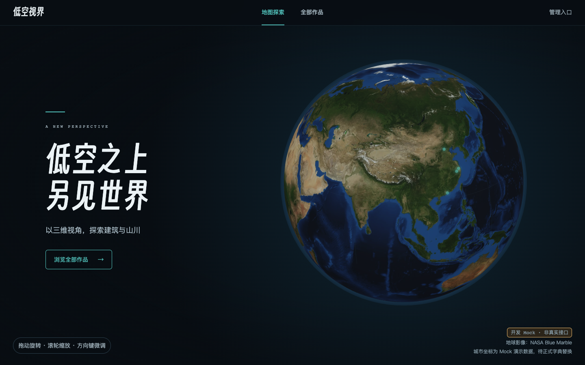

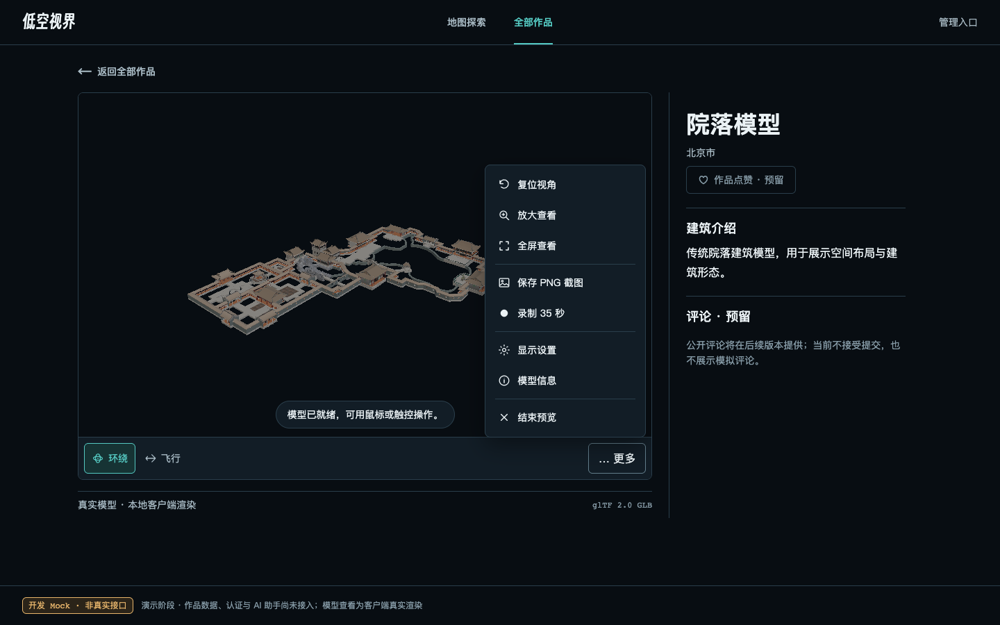

## 6. 第二轮视觉校准

用户反馈首版与效果图的美感差距明显，本轮按参考图重新校准视觉重心：

- 标题由斜体改为直立粗黑体，桌面字号提高到 64–112px，收紧字距并上移文案区；品牌字形同步调整。
- 首页文案左边距、按钮、底部细分隔线和操作提示重新对齐，移除提示的药丸背景。
- 地球调整尺寸与水平位置，增加静态真实云层，使用偏侧上方的暖白主光与色调映射，削弱硬边缘光。
- 本地演示数据中的院落、长城使用项目现有封面，其他占位作品保持明确占位；不修改线上业务数据。
- 城市气泡缩小到 280px，使用更克制的圆角；查看器工具栏改用细线和下划线选中态。
- 真实模型相机初始化同步环绕中心到模型中心，避免自动旋转造成构图偏移。
- 保留菜单功能、点赞评论预留及原作品目录，不更换真实模型材质和几何。

本轮类型检查、Lint、生产构建通过；301 条单测通过（4 worker），3 条相关 Chrome E2E 通过，并在接入项目封面后重跑首页／详情与目录共 17 条 E2E 全部通过；加上显示参数专项，本轮覆盖 18 条不同场景。真实模型与生成图中的建筑资产仍有差异。

第二轮实际页面：

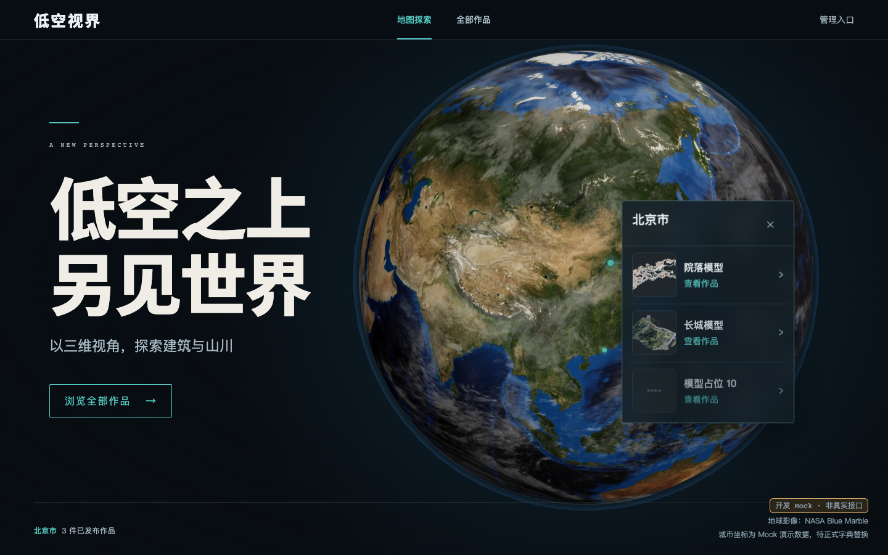

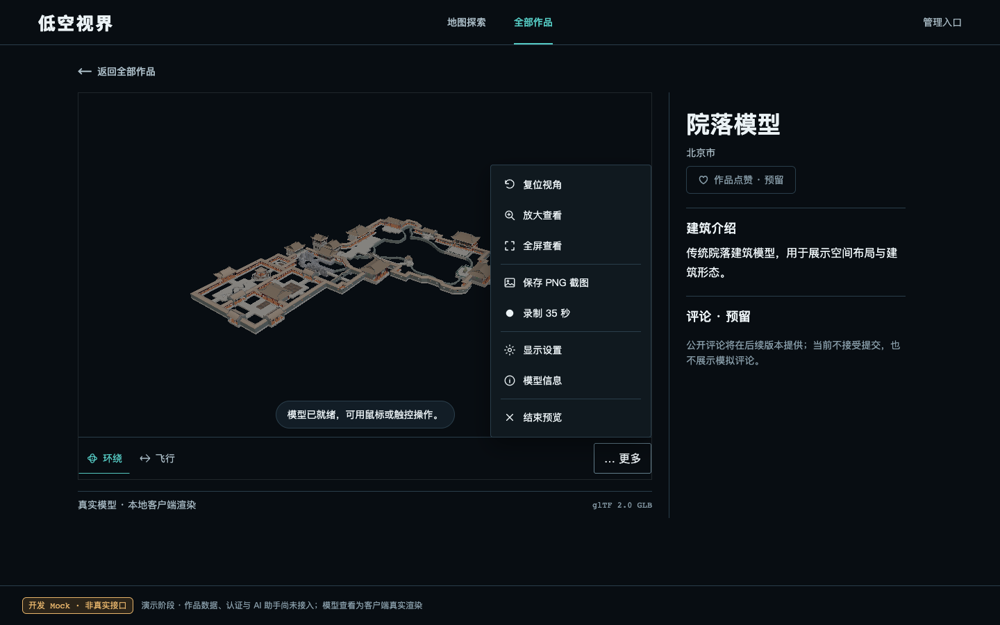

## 7. 首页背景层次补充

根据用户反馈“背景有些空旷”，只为首页地球场景添加静态装饰：疏落星点、外围轨道及刻度、左下方地形等高线、右上角地理视野标记。线条沿用银灰与青绿色，放在地球画布后方，等高线避开目录按钮；手机隐藏等高线和文字标记，轨道按实际场景尺寸适配。

装饰使用原生 SVG 与 CSS，不引入图片、依赖、持续动画或逐帧计算。整个装饰层 `aria-hidden` 且 `pointer-events: none`，不参与键盘导航或地球交互。

验证：类型检查、Lint、生产构建通过；首页视觉用例覆盖 1440 / 390 / 320px，并检查实际桌面与手机截图。扩展回归共 6 条通过、2 条失败、7 条因串行测试中断未执行。两处失败在隐藏新装饰后仍可复现：`city-bubble.spec.ts:157` 要求手机气泡总在点位下方，但当前空间不足时位于上方且仍在场景内；`home.spec.ts:148` 固定点击 `(120,650)`，目前该位置是“浏览全部作品”按钮，导致离开首页。这两条旧布局测试本轮没有改动，不将扩展套件记为全部通过。

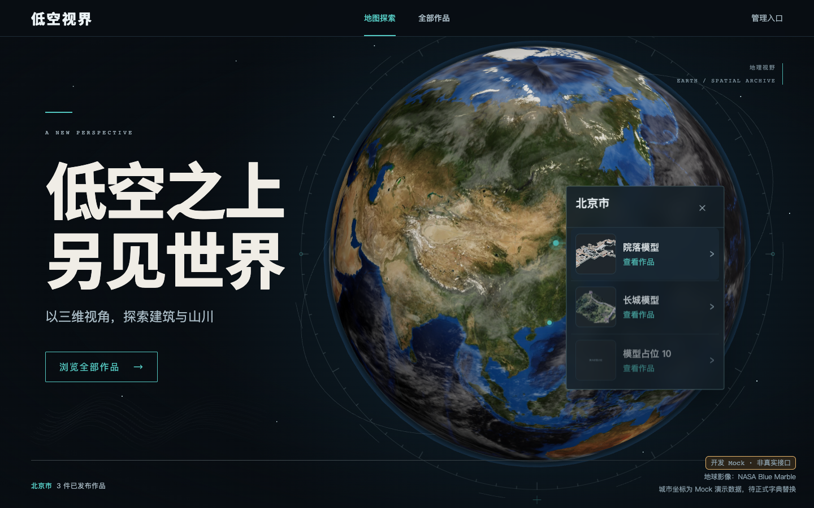

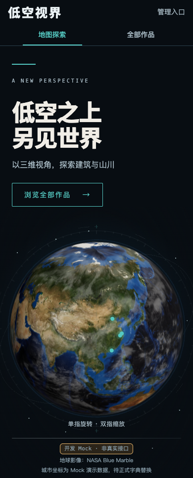

## 8. 常用视图操作移出更多

根据用户标注，将“复位视角、放大查看、全屏查看”移到主工具栏，与环绕、飞行并列，更多菜单删除这三个重复入口。保留原有就绪状态限制、复位逻辑、页内放大切换及浏览器全屏行为；恢复常规查看后焦点返回主工具栏的放大按钮。

窄于 560px 的查看器使用图标按钮，保留完整可访问名称与提示；320 / 390px 实测六个入口均在视口内，点击区域至少 44px。截图、录制、显示设置、模型信息和结束仍位于更多。

验证：类型检查、Lint、生产构建通过；工具栏与预览外壳 13 条单测通过；真实模型常用工具、放大焦点恢复、Orbit/Fly 交互及全屏、320/390/768/1440 显示参数布局共 4 条 Chrome E2E 通过。

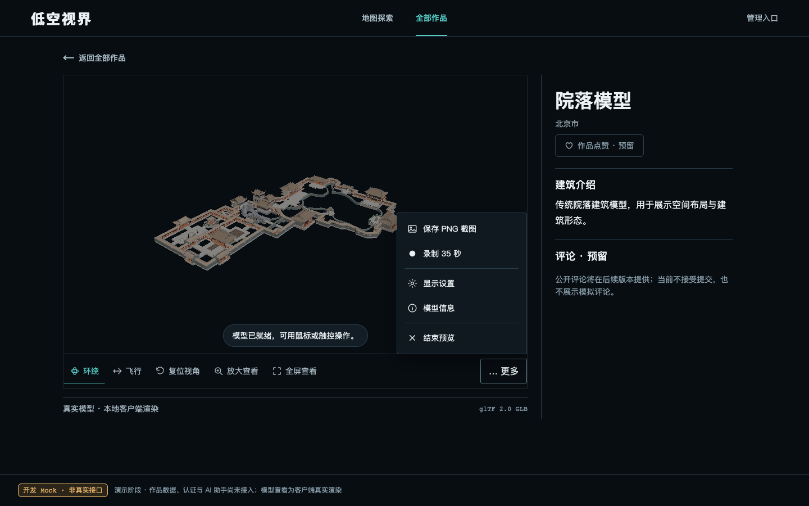

## 9. 地球云层空间分层

用户反馈云层与大陆像在同一图层。本轮拉开地表、近地云影、独立云层和大气外壳的间距，云层加入轻微几何起伏与独立受光凹凸，增强漂浮感；降低环境光，让侧向光下的云团与地表明暗更清楚。

云层以每秒 0.003 弧度缓慢漂移，云影同步移动，不旋转地表或改变城市位置；系统开启减少动态效果时停止漂移。继续复用现有纹理，新增一个近地云影球壳，不引入额外贴图、后处理或完整阴影贴图渲染。云高比例为展示作视觉夸张，云影为轻量近似，尚未使用体积云。

验证：类型检查、Lint、生产构建通过；19 条地球计算单测、3 条首页 Chrome E2E 通过（桌面稳定点位、1440/390/320px 首页、减少动态模式）。额外在真实 Chrome 比较间隔 2.2 秒的画布截图：普通模式云层画面变化，减少动态模式画布保持一致；控制台无错误。已检查默认与拖动后的实际页面截图。

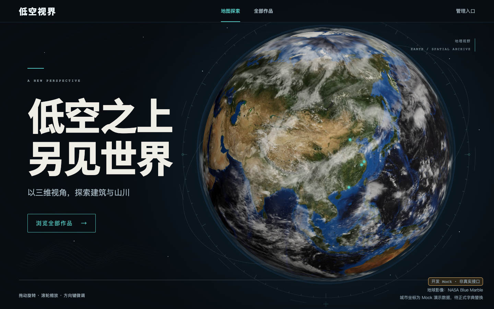

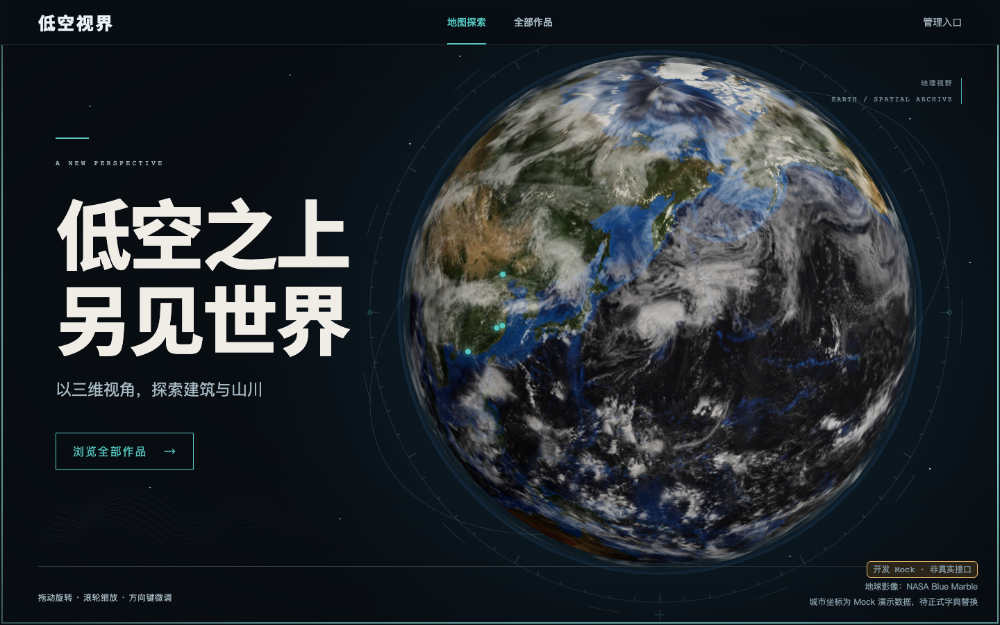

## 10. 撤回浅蓝海洋配色

按用户要求恢复上一版原始海洋纹理颜色，移除统一浅蓝的材质处理，保留第 9 节的独立云层、云影与大气效果。

## 11. 全部作品的展览目录排布

根据用户认为目录卡片“有点朴素”的反馈，更新初版保持原卡片排列的约束。1280px 起第一件作品横跨两列，与第二件形成首排一大一小；后续作品仍为三列。768px 起双列、手机单列，保持契约排序、完整目录、整卡单链接与返回焦点恢复。

标题区加入真实作品数量与空间档案标记，改写目录介绍。卡片使用细线画框和留白，信息按编号、地点、标题、模型类型、查看入口分层；首件展示真实建筑介绍。箭头在悬停或键盘聚焦时强调，减少动态模式禁用位移动效。封面保持完整显示，未生成或替换业务封面，开发占位作品仍明确占位。

宽幅比例设为 2.2，维持原有详情封面连续转场的比例容差；首排信息区等高，骨架屏匹配新的宽幅排布。没有新增筛选、搜索或业务接口。

验证：13 条 UI 单测、15 条目录及详情 Chrome E2E 全部通过；类型检查、Lint、生产构建通过。另检查 320 / 390 / 768 / 1440px 无横向溢出，并检查桌面与手机实际截图。

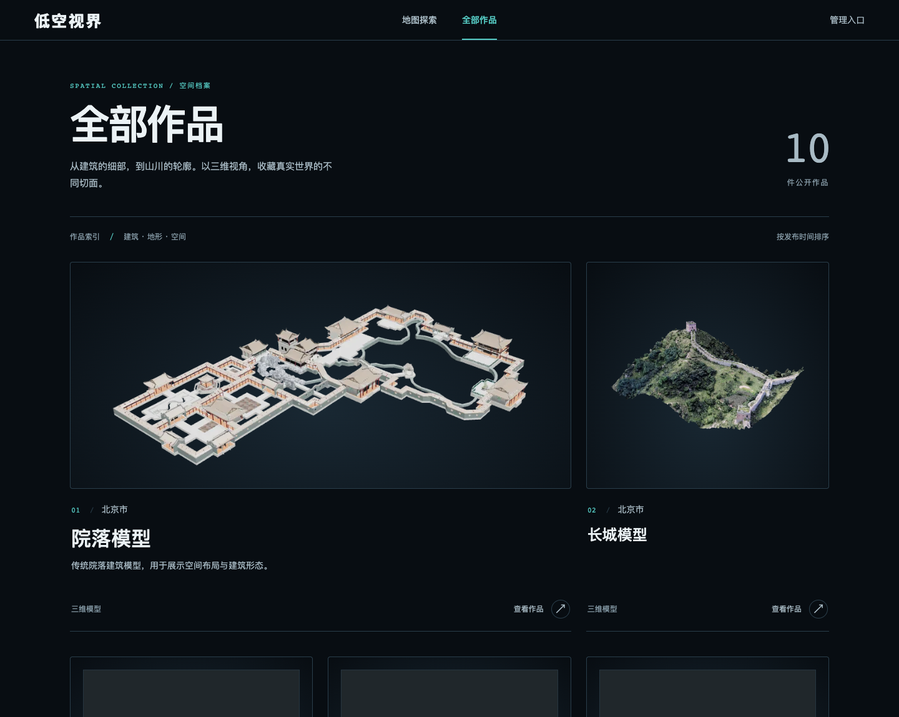

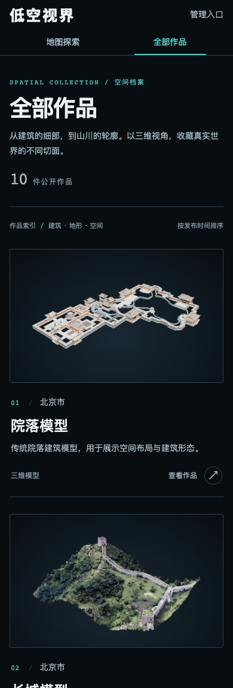
