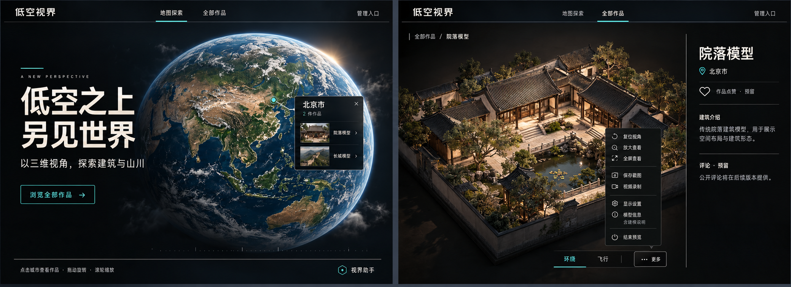

# 低空视界 · UI 优化设计与前端实施方案

创建日期：2026-10-31。版本：v0.1。状态：**设计与验收依据；2026-10-31 首版前端已实施，实际检查与未验收范围见 [UI 优化实施记录](UI优化实施记录.md)。**

本文将本次对话已经确认的设计要求、最新效果图与当前本地前端实现合并为可执行方案。文中尺寸是首版实施参数，不是现有页面的测量结果；性能指标是验收目标，不代表已经达到。

## 1. 目标、依据与适用范围

### 1.1 本轮目标

把当前网站升级为以真实地理探索和三维实景观看为核心的“低空视界”。保留已有作品浏览与真实模型查看能力，通过品牌、排版、彩色地球、观看区构图和工具收纳提高完成度。

整体视觉采用深色、冷青强调色与自然彩色内容。建筑模型是主体，界面承担引导、控制与说明职责。借鉴参考图的留白和展览光影，不照搬其中的旧站名、虚构功能、蓝图建筑或统一暖色滤镜。

### 1.2 已确认的产品决定

| 项目 | 最终要求 |
| --- | --- |
| 网站名称 | 低空视界；替换公开导航、浏览器标题等位置的“建筑模型展厅” |
| 首页标题 | 两行：“低空之上”“另见世界” |
| 首页副文案 | 以三维视角，探索建筑与山川 |
| 首页入口 | 浏览全部作品，进入现有 `/works` |
| 地球 | 带自然颜色的真实风格；蓝色海洋、绿色植被、褐色地形，避免与背景同色 |
| 字体气质 | 品牌与首页大标题采用具有设计感的现代科技黑体，正文保证易读 |
| 地球大小 | 比现有默认构图稍小，为文案、点位和气泡留出空间 |
| 作品目录 | 保留用户图 2 的卡片排布；本轮不重做目录信息架构 |
| 详情右侧 | 保留作品名、城市、作品点赞预留、建筑介绍、评论预留 |
| 建模说明 | 与模型信息合并，不再单独占据右侧信息卡片 |
| 常驻工具 | 仅“环绕、飞行、… 更多” |
| 其他功能 | 复位、放大、全屏、截图、录制、显示设置、模型信息、结束预览均放入“更多” |
| 步行 | 删除功能与相关前端操作路径，不移入“更多” |

后续“其他功能都放入更多”的决定覆盖早期效果图中独立显示复位、全屏按钮的安排。

### 1.3 视觉参考

最终方向图已归档到项目，文档与图片可以一并交付：



原始三方向参考见 [A／B／C 参考图](../ChatGPT%20图像%202026年10月22日%2016_14_33.png)。借鉴关系如下：

| 来源 | 借鉴内容 | 在本项目中的使用位置 |
| --- | --- | --- |
| A 墨·纸·朱砂 | 大标题节奏、左右构图、内容留白、简洁导航 | 首页文案区、详情标题、展签式信息层级 |
| B 蓝晒图纸 | 细线、短刻度、精确对齐、等宽元信息 | 区域分隔、模型信息、菜单分组；不转为整页蓝图风格 |
| C 石灰·展灯 | 建筑主光、屋檐阴影、材质与空间体积 | 真实模型的观看构图与可用光照调校 |

效果图中的建筑、地球细节、字形与光影为生成式示意。真实页面采用真实地球素材和已有模型文件；不以生成图替代可交互模型，不将示意建筑介绍写入正式作品数据。

### 1.4 与旧规范的关系

- 基础颜色、对比度、焦点、表单和后台规则继续采用 [视觉规范 v1.0（深色）](视觉规范v1.0（深色）.md)。
- 核心开场、城市联动、封面连续转场继续采用 [动效设计 v1.0](动效设计v1.0.md)。本次不把正常模式的复杂动效统一删成淡入淡出。
- 本文明确覆盖旧规范中的站名、首页构图、手机首页高度策略、工具栏组织、建模说明位置与步行能力。
- 未被本文覆盖的业务规则不变，尤其是城市选填、同城聚合、权限检查、显式开始预览、远程不可用降级和资源释放。
- 实施时更新实际受影响的规范条目与工程说明，保留历史记录，不批量改写历史会议纪要和旧参考图。

### 1.5 本轮不包含

- 不新增搜索、路线、统计、点赞提交、评论提交或模型下载业务。
- 不重做后台上传、发布、认证流程，不新增后端业务接口。
- 不用首页展示型效果图推导出新的城市或作品数据。
- 不新增聊天机器人或假助手入口。线上客服组件维持现状，详见第 12 节。
- 不自动发布线上，不以文档完成代表前端实现完成。

## 2. 当前实现与实际问题

### 2.1 现有工程基础

当前前端使用 React、TypeScript、Vite、CSS Modules、React Router、TanStack Query、Three.js、React Three Fiber 与 GSAP。无需更换框架或引入新的 UI 组件库。

| 子系统 | 当前实现位置 | 本次作用 |
| --- | --- | --- |
| 应用品牌与配置 | `frontend/src/app/env.ts`、`frontend/index.html` | 名称、标题、页面描述与配置回退 |
| 全局设计变量 | `frontend/src/styles/tokens.css` | 新增展示字体和首页专用尺寸，保留原有基础变量 |
| 首页 | `frontend/src/pages/HomePage.tsx` 及对应 CSS | 可见主标题、文案与场景分区 |
| 地球渲染 | `frontend/src/components/globe/Earth.tsx` | 彩色纹理、主光、经纬线和大气层 |
| 地球交互 | `frontend/src/components/globe/GlobeExperience.tsx`、`frontend/src/lib/globeMath.ts` | 构图、投影、点位命中、气泡避让 |
| 公开导航 | `frontend/src/components/layouts/PublicNav.tsx` 及对应 CSS | 新品牌、紧凑导航、管理入口降权 |
| 详情信息 | `frontend/src/pages/WorkDetailPage.tsx` 及对应 CSS | 右侧信息和观看区比例 |
| 预览外壳 | `frontend/src/components/works/PreviewViewer.tsx` 及对应 CSS | 封面、显式开始、状态、页内放大 |
| 查看器 UI | `frontend/src/components/viewer/ModelViewport.tsx` 及对应 CSS | 工具栏、更多、设置、模型信息、录制状态 |
| 本地渲染核心 | `frontend/src/viewer/ModelViewer.ts` | 环绕、飞行、参数、截图录制与步行清理 |
| 远程控制适配 | `frontend/src/viewer/RemoteModelViewer.ts`、`controller.ts`、`RemoteInput.ts` | 共用操作、远程能力校验与兼容 |

这些文件是改动定位依据，不要求把每个文件都改一遍。只有受具体需求影响的代码才进入补丁。

### 2.2 已观察到的问题

1. 当前地球使用按深色规范重绘的演示纹理，陆海颜色接近背景，缺少自然地理色彩。
2. 首页标题仅作为读屏内容，视觉上缺少明确的站点主题与下一步引导。
3. 窄窗口出现两行导航，占据较多垂直空间，管理入口与参观入口同权。
4. 查看器工具栏功能密集，既有模式选择，也有参数、导出和结束操作，容易换行。
5. 当前窄窗口详情页中“开始预览”说明区域超出封面，主按钮被 `overflow` 裁切；向下滚动后仍不能完整看到按钮。
6. 模型信息包含实用的格式、尺寸和帧统计，但入口与其他主操作并列，影响观看区简洁度。
7. 建模说明在详情卡片、模型技术信息在查看器内，相关资料分散。
8. 步行不仅有按钮，还涉及设置、状态、输入、传送、控制器类型和远程能力校验，不能仅删除图标。
9. 线上白色客服提示会抢占注意力，但它不是本地 React 工具栏的一部分，需与本轮代码边界区分。

## 3. 品牌、视觉变量与字体

### 3.1 站名替换范围

将面向用户的当前站名统一为“低空视界”：

- 导航品牌、管理布局中实际引用站名的位置。
- `index.html` 的 `<title>` 与 description。
- `appConfig.appName` 默认值、`.env.example` 与对应测试预期。
- 与本次实现相关的当前工程介绍及配置说明。

继续保留 `VITE_APP_NAME` 配置能力。正式构建前检查该变量是否仍为旧名；不要只修改代码默认值后忽略环境覆盖。不得输出其他环境变量或凭据。

### 3.2 色彩与表面

| 角色 | 首版值 | 使用约束 |
| --- | --- | --- |
| 页面背景 | `#080D12` | 沿用现有底色，不为接近图片随意重配全站 |
| 实色面板 | `#121D26` | 信息面板、更多、设置与说明 |
| 图像承托底 | `#20272B` | 沿用目录封面；详情观看区与封面交接需保持连续 |
| 主文字 | `#EBF2F5` | 品牌、标题、正文 |
| 次文字 | `#A8BAC4` | 城市、说明、玻璃上的辅助内容 |
| 辅助文字 | `#879CA8` | 实色表面上的非关键元信息 |
| 强调色 | `#54C8C1` | 当前模式、当前导航、点位与主入口 |
| 分隔线 | `#2A3E4B` | 装饰分组，不代替必要控件边界 |
| 控件边界／焦点 | 沿用现有变量 | 保持辨识度，不用更暗的装饰线代替 |

圆角继续使用现有层级：面板 8px、控件 6px、浮层 12px。效果图中的尖角只作为克制感参考，不增加一套互相冲突的圆角体系。

减少连续套框：详情外壳、画面和提示卡不再同时强调完整边框。正文和工具面板用实色；不扩大玻璃面积，不用低透明度文字制造“高级感”。

### 3.3 字体方案

新增 `--font-display`，与现有 `--font-sans`、`--font-mono` 分开。

- 品牌和首页大标题：现代中文展示黑体，优先考察宽字面、几何骨架、带少量切角的字形。展示字体初选可考察得意黑（Smiley Sans），但最终入库前必须核对官方许可、字形与效果图的适配；**当前没有声称该字体已经安装或获得资源**。
- 正文、导航、目录卡片、表单：沿用现有中文黑体回退栈，不进行全站装饰字体替换。
- 格式、文件大小、帧率和技术标签：沿用等宽字体变量。
- 任何新字体必须来自可核实的发行源，保留许可。资源与字形确认属于实施前资产任务，不能下载不明授权的“科技字体包”。

字体使用本地 WOFF2，`font-display: swap`。展示字体尽量仅包含品牌、标题和必要标点的子集，具体是否允许子集化以许可为准；缺字回退为正文黑体。不得以远程字体服务可用作为首页出现的前提。

### 3.4 排版起始参数

| 元素 | 桌面 | 平板 | 手机 |
| --- | --- | --- | --- |
| 品牌 | 24px / 32px，字重随展示字体 | 22px / 30px | 22px / 30px |
| 首页主标题 | 64–80px，行高 1.12 | 48–60px，行高 1.16 | 38–48px，行高 1.2 |
| 首页副文案 | 18px / 30px | 16px / 28px | 16px / 26px |
| 详情作品名 | 30–34px / 42px | 28px / 38px | 26–28px / 36px |
| 详情小节标题 | 18px / 26px | 18px / 26px | 18px / 26px |
| 正文 | 16px / 28px | 16px / 28px | 16px / 26px |
| 菜单标签 | 14–16px，行高 22px | 同桌面 | 16px / 24px |

首页标题用局部 `clamp()` 在范围内插值，不改目录页原有标题尺寸。标题固定在两个完整语义行分行，不能用任意逐字断行或过大字距撑开容器。副文案独立限制行宽，不与球体相交。

## 4. 导航与响应式布局

### 4.1 桌面导航

宽度 ≥768px 时采用单行：品牌在左，地图探索／全部作品居中，管理入口在右。导航高度首版 64px，通过公开导航专用变量控制，避免影响后台布局。

活动项使用短冷青下划线，保持 `NavLink` 的当前项语义；“管理入口”字号 14px、次文字色，路由仍为 `/admin`。不新增“关于”、搜索或其他导航。

### 4.2 手机导航

宽度 <768px：第一行品牌和管理入口 48px，第二行仅地图探索／全部作品 44px，总高 92px，不使用第三行，也不新增汉堡菜单。两项主导航各占一半宽度。

管理入口保留至少 44px 可点击区域。顶部实色，不在手机上叠加大面积模糊层。关注横屏、长品牌回退字体与 200% 缩放，不允许横向溢出。

### 4.3 布局断点

继续沿用 768 / 1024 / 1280 三个主要断点，不引入大量零碎断点。

| 宽度 | 首页 | 详情 | 目录 |
| --- | --- | --- | --- |
| <768 | 文案在上，地球在下，必要时整页滚动 | 观看区在上，资料在下 | 原单列规则 |
| 768–1023 | 紧凑左右构图；高度不足时允许滚动 | 上下布局 | 原双列规则 |
| 1024–1279 | 左文右球 | 约 70/30，信息区最小 300px | 原双列规则 |
| ≥1280 | 留白更充分的左右构图 | 约 70/30 | 原三列规则 |

公开页基础内容上限继续沿用 1280px，首页背景和地球场景可铺满视口。文案与详情内容的左右对齐基线要一致。

## 5. 首页设计与地球升级

### 5.1 内容顺序

1. 品牌导航。
2. 首页两行主标题、简短副文案、作品目录入口。
3. 可交互彩色地球、真实城市点位、单个城市气泡。
4. 操作提示与必要的开发／数据说明。

主标题必须成为真正可见的 `h1`，取消旧的仅读屏标题，避免同一页面出现两个重复主标题。英文微标签可用 `A NEW PERSPECTIVE`，只作辅助，不承担必要信息。

首页不展示作品统计、虚构经纬度或与数据无关的导航轨迹。城市名称和作品数全部来自现有 API，效果图的“北京 2 件”不是硬编码需求。

### 5.2 构图与相机

- 桌面文案约占内容宽度 36%，地球主要位于右侧 64%；两区至少留出 32px 安全间隔。
- 桌面默认球心目标约在场景宽度的 68%、高度的 52%，依据实际安全区微调。
- 初始球体目标直径约为现有尺寸的 85%，同时约束在可用高度的 72%–78%内，完整显示大气层。
- 用户主动缩放后允许更近的观察，不能为维持完整轮廓取消已有缩放能力。完整球体要求针对默认稳定构图。
- 手机文案独立占据正常文档流，地球场景初始高度约 `clamp(320px, 56svh, 520px)`，球体直径不超过场景宽度的 92%与高度的 86%。
- 手机取消当前以 `100dvh` 配合整页 `overflow: hidden` 强行塞满一屏的策略，底部说明始终可通过滚动到达。

构图通过 `globeDiameterForViewport()`、`globeViewOffset()` 及场景实际尺寸统一计算，不单独用 CSS 平移 canvas 或只缩放点位层。相机、点位、命中区和气泡必须共享同一个场景坐标系。

### 5.3 地球纹理与渲染

当前 `earth-demo.png` 为双色演示资产。本次新增彩色资源，不静默覆盖旧图及其来源记录。

| 资产 | 规格与约束 |
| --- | --- |
| 桌面纹理 | 4096×2048，2:1 等距圆柱投影 |
| 移动纹理 | 2048×1024，同一图源、同一经纬度原点 |
| 图像内容 | 自然海洋、植被、地形、极地；不使用 AI 生成世界地图作为地理纹理 |
| 部署方式 | 本地静态资源，记录来源、许可／使用条件与处理方式 |
| 色彩 | sRGB，避免双重颜色转换或统一冷青染色 |

实施时从可核实的官方地球影像来源取得素材并核对使用条件。图源尚未取得、地理方向未校验时，不能将“演示素材待接入”改为正式地理已验收。

第一版采用单层彩色球面、柔和主光、少量环境光与弱大气层；经纬线降低存在感。暂不增加动态云层、城市夜光、复杂地形位移或满屏 Bloom。

光照要保证旋转后的可见半球依旧可辨。参考图右上角的太阳光只借鉴明暗方向，不额外增加闪耀太阳、镜头光斑与高亮星空。环境背景保持深色稳定。

### 5.4 点位与城市气泡

- 保留每城一个点位、同城作品聚合，城市为空的模型继续只走目录。
- 点位视觉小，点击区域至少 44×44px；不以缩小命中范围解决拥挤。
- 标签优先展示选中城市和当前悬停城市，避免大量常驻标签互相覆盖。
- 气泡保留城市名、作品数、关闭按钮和模型列表；封面、名称与箭头形成一个链接目标。
- 桌面气泡宽度首版 280–320px；手机不超过可用宽度，保留原本靠近点位的关系，长列表内部滚动。
- 避让顺序增加标题、导航、页底提示的安全区；标题作为不可覆盖区域，不能只检查视口四条边。
- 开场中操作立即接管，返回首页恢复视角；资源变更后旧动画和旧位置信息必须正确失效。

### 5.5 加载与降级

字体、纹理、城市 API 独立加载，不以任一未完成阻止导航与作品目录入口使用。地球暂未就绪时保留稳定背景和真实加载提示，避免空白闪烁。

纹理失败或 WebGL 不可用时显示明确说明和目录入口，不把静态生成图伪装成可交互地球。城市 API 失败保持现有手动重试；不能用效果图里的北京点替代失败数据。

## 6. 全部作品目录的保留范围

以下为初版目录要求。用户后续要求优化卡片排列，当前实现已更新为桌面首排一大一小、后续三列，详见《UI优化实施记录》第 11 节；排序与一次展示全部作品的方式仍保留。

- 卡片仍为 16:10 封面、作品名、城市／未设置城市。
- 图片继续完整承托，不因效果图裁切建筑主体，也不改成正面建筑照片。
- 手机单列、768px 起双列、1280px 起三列。
- 保留骨架、加载、失败、空态、返回滚动位置与卡片焦点恢复。
- 保留与城市气泡／详情封面之间的已有连续转场。
- 允许的变化仅包括共享站名、公开导航、必要的焦点兼容和受详情改动影响的转场目标修正。

首页和详情的新展示字体不得通过全局 `h1/h3` 选择器意外改动目录版式。

## 7. 模型详情页

### 7.1 观看与阅读区域

桌面保持左观看、右介绍。观看区优先获得空间，右侧最小宽度 300px，列间距 24px。观看区减少外壳重复内边距与重边框，但保留清楚的可操作区域边界。

窄屏先展示作品识别信息和观看区，完整的介绍内容在下方。通过 CSS 排版重用语义清楚的标题，不复制两个可访问的 `h1`。

模型框应完整呈现模型边界，保留适量画面余量。封面使用现有素材，真实观看使用现有模型；不能直接用生成的精美院落替换真实模型文件。

### 7.2 右侧信息顺序

1. 作品名：本区域最高文字层级。
2. 城市：次文字；无城市沿用“未设置城市”。
3. 作品点赞预留：心形标记＋“作品点赞 · 预留”，不是按钮，不展示虚构计数。
4. 建筑介绍：正文保留换行与纯文本语义。
5. 评论预留：“评论 · 预留”＋现有未开放说明，不增加输入框、假评论或提交能力。

建模说明不再单列在右侧。长介绍允许自然滚动，不在本轮新增“展开全文”业务或改变纯文字存储格式。

### 7.3 开始预览与状态布局

保留现有“封面 → 用户显式开始 → 可用性检查 → 申请渲染／加载 → 首帧 → 交互”过程。不能为了接近效果图改成进入详情后立即申请 GPU 或下载模型。

预览前文案采用简短标题与一条必要说明，例如“进入三维预览”；说明仍需表达远程不可用时可能切换本机并下载模型。不要隐藏影响用户流量与等待预期的信息。

首版统一将预览前操作区放在封面之后的正常布局流中，避免绝对定位卡片被封面的固定比例和 `overflow: hidden` 裁切。封面区域继续保留 16:10，适配已有封面转场；开始后观看容器为工具栏和可用画面分配真实高度。

加载、错误、重试、资源繁忙、作品不可用和结束态仍使用清晰可见的状态区。错误恢复按钮不强行藏进“更多”；“更多收纳”针对正常观看工具，不针对故障恢复。

### 7.4 真实模型的画面调校

| 模型类型 | 本轮可调内容 | 明确边界 |
| --- | --- | --- |
| GLB | 相机、暖色主光、柔和补光、已有材质和已有发光控制 | 不凭空替换材质或增加新的自发光 |
| 网格 PLY | 相机、补光、顶点色与方向纠正 | 不把查看器可读等同于正式上传链路支持 |
| 高斯 PLY | 相机、已有色调、splat 尺度、Bloom 等现有能力 | 保留采集光照，不套用网格灯光与实时阴影方案 |

现有网格补光已经包含暖色方向光，可先校准强度和机位。第一版不增加全场景实时阴影、环境贴图下载或新后处理链；只有实测表明现有能力不足且成本可接受，再单独讨论。

本地与远程使用同一组已支持的参数含义。远程节点不支持的画面提升不在前端单方面伪装实现；记录本地与远程实际差异。

## 8. 查看器工具栏与更多菜单

### 8.1 常驻结构

```text
┌─────────────────────────────────────────┐
│            真实模型画面                 │
├─────────────────────────────────────────┤
│ 环绕   飞行                    … 更多   │
└─────────────────────────────────────────┘
```

工具栏位于画面下方，属于查看器根容器，与画面一起进入页内放大和浏览器全屏。通过 flex/grid 真实分配高度，不覆盖模型主要区域。原有顶部多按钮工具栏移除。

环绕和飞行显示图标＋文字，当前项使用填充或短下划线并保留 `aria-pressed`。飞行在模型未就绪或粗指针触屏下延续现有限制，显示禁用原因；本轮不新增触屏飞行摇杆。

### 8.2 菜单条目与状态

| 顺序 | 入口 | 执行与状态要求 |
| --- | --- | --- |
| 1 | 复位视角 | 复用 `resetView`；保留 F 快捷键，模型就绪后可用 |
| 2 | 放大查看 | 复用页内放大；已放大时显示“恢复常规查看”；无宿主能力则不渲染该项 |
| 3 | 全屏查看 | 复用 Fullscreen API；已全屏时显示“退出全屏”；失败给出页内放大提示 |
| 4 | 保存截图 | 调用现有 PNG 导出；未就绪时禁用 |
| 5 | 视频录制 | 未录制显示“录制视频（最长 35 秒）”；录制中显示“停止录制”；结束处理中禁用重复点击 |
| 6 | 下载视频 | 仅有可下载录制结果时出现，沿用原文件名和格式逻辑 |
| 7 | 显示设置 | 打开现有参数面板；保留各格式能力边界 |
| 8 | 模型信息 | 打开合并信息面板，辅助文字“含建模说明”仅在确有说明时出现 |
| 9 | 结束预览 | 独立分隔；沿用宿主提供的回调与 `showEnd`，结束前按现有逻辑停止录制 |

按“视角”“导出”“设置与资料”“结束”划分视觉组，只使用分隔线，不增加额外多级菜单。

截图、录制继续导出模型画面而非网页 DOM；保留现有 Bloom 合成、35 秒上限、手动停止与无音频约束。录制状态在菜单关闭时也可见，但不新增菜单外的操作按钮。

“恢复常规查看”和退出全屏是退出当前特殊布局的必要路径：更多内保留对应操作，宿主模态的关闭按钮和浏览器原生 Escape 退出不删除。

### 8.3 菜单定位与层级

- 桌面菜单宽度首版 232px，行高至少 44px；优先从工具栏向上展开，空间不足时调整方向。
- 最大高度受查看器实际可视区域限制，长菜单内部滚动；横向至少保留 8px 边距。
- 不使用固定 `top: 112px/168px` 推算工具栏位置，改为从触发按钮和实际容器边界计算。
- 手机使用查看器内的限高滚动面板；低高度场景由外壳提高观看容器最小高度，不能让菜单变成不可操作的细条。
- 菜单、设置、信息层挂在查看器根节点内，不 portal 到 `document.body`，避免浏览器全屏后消失。
- 不得改变页面的现有导航、放大模态层级体系。局部层级为画面、状态、工具／菜单、参数／信息、提示；状态恢复入口不能被不可关闭浮层覆盖。

### 8.4 键盘、焦点与相机输入

采用语义完整的菜单按钮：`aria-haspopup="menu"`、`aria-expanded`、`aria-controls`；菜单项支持上下键、Home/End、Enter/Space 和 Escape。禁用条目保持语义，不响应动作。

打开菜单前清除移动键与鼠标拖动输入。打开设置／信息时沿用参数交互的暂停机制，关闭后正常结束该交互。焦点位于菜单、滑块、选择器、输入框时，WASD、F 等查看器快捷键不能抢走输入。

Escape 按最内层优先：先关闭正在打开的子面板／菜单，再处理页内放大；只有实际处理当前事件才阻止其继续传播。浏览器原生退出全屏行为不拦截。

菜单普通关闭后焦点回到“更多”。执行动作后：打开面板则聚焦面板标题／首控件；关闭面板回到“更多”；结束预览后回到开始入口。页内放大关闭后的焦点目标从旧的独立放大按钮改为当前可见的“更多”，不能指向已被收起或卸载的菜单项。

### 8.5 面板互斥与实例稳定

只允许菜单、设置面板、模型信息面板之一作为当前打开的功能层。由菜单进入面板时关闭菜单，面板自带关闭入口，不叠多层模糊遮罩。

开关菜单、修改建模说明、切换普通／放大布局都不能重新创建 `ModelViewer`、远程会话或解析整份模型。仅模型来源、版本和实际渲染配置变化按原逻辑触发加载。

## 9. 显示设置与模型信息

### 9.1 显示设置保留项

| 分组 | 功能 | 保留限制 |
| --- | --- | --- |
| 方向 | 源坐标系自动／Z-up／Y-up，X/Y/Z +90°，重置方向 | 更新真实边界与相机，不改源文件 |
| 画面 | Bloom 开关和强度，原色／统一色调 | 不以 Bloom 代替真实材质 |
| 高斯 | 单 splat 尺度 | 仅高斯 PLY 可用，不缩放整个模型 |
| 光照 | 柔和补光与强度 | 仅支持的网格类型使用 |
| 材质 | 原有发光材质与强度 | 仅具备原有发光能力的 GLB；统一色调等限制继续生效 |
| 交互 | 自动旋转、飞行速度、触控开关 | 自动旋转仅环绕；触屏继续不启用飞行 |
| 恢复 | 恢复显示默认 | 不等同复位相机，不意外修改来源与业务数据 |

移除步行速度、地面、视角高、起点、可信区域和二次确认说明。同步改写“方向变化作废步行确认”等过时文案。

自动旋转延续现有 6°/s、交互期间暂停、结束后等待 15 秒恢复等语义；减少动态偏好下不默认开启。参数变化不重新解析模型，滑块操作不引发场景重建。

### 9.2 模型信息组织

合并信息面板按以下顺序排列：

1. **建模说明**：来自作品的 `modelingNote`，纯文本保留换行；为空或纯空白时整个小节不渲染。
2. **模型资料**：来源名称、格式、文件大小、显示坐标系、方向叠加、包围盒，以及实际格式可提供的点数／面数、球谐阶数、材质与贴图统计。
3. **当前会话统计**：画布尺寸、DPR、fps、p50/p95、长帧、draw calls、几何／纹理及浏览器可提供的内存信息。

缺失字段显示“—”或现有解释，不补假数据，不将相对坐标和包围盒宣称为米。远程节点未提供某项统计时不能拿本机帧率冒充远端模型渲染性能。

来源字段以作品名称／资源名称为主，技术 URL 仅按现有授权范围展示，不新增原始模型下载入口，不暴露会话凭据或内部调试信息。

### 9.3 数据流与最小接口变化

```text
公开作品 / 管理作品
  └─ modelingNote（已有业务字段）
      └─ PreviewViewer：新增可选展示参数
          └─ ModelViewport：新增可选展示参数
              └─ 更多 → 模型信息 → 建模说明

preview-config / 模型来源
  └─ 继续原加载路径，与文字展示参数分离
```

建议 `PreviewViewerProps` 与 `ModelViewportProps` 新增 `modelingNote?: string | null`，由公开详情和管理员预览显式传入。它只影响说明面板，不并入渲染配置，不成为加载 effect 或 viewer 实例 key 的依赖。

开发查看器测试页没有作品说明时可省略参数。无需更改作品 API、上传 API、数据库字段或远程消息格式。

## 10. 步行功能移除与兼容

### 10.1 前端清理范围

步行从公共观看、管理员预览、开发查看器三个入口一致移除：

- 删除步行按钮、图标引用、配置面板、确认流程、速度控件与提示。
- `ViewerMode` 收敛为 `'orbit' | 'fly'`；模式切换与状态事件不再提供步行。
- 清理本地查看器独占的地面约束、步行姿态、步行移动、点击传送和相关内部状态。
- 控制器接口不再要求 `getWalkDefaults`、`configureWalk`、`setWalkSpeed`。
- 模型坐标纠正、飞行、环绕、边界计算等共用逻辑继续保留，不因清理步行误删。
- 本次改动造成的无用样式、导入、函数与测试夹具同步清理；不借机删除无关历史代码。

### 10.2 旧配置字段

现有 preview-config 可能包含 `ground`、`eyeHeight`、`walkStart`、`walkArea`、`walkAreaTrusted`。本轮不要求后端删除字段或进行数据库迁移。

若前端解析需要兼容这些旧字段，将其保留为明确弃用的可选输入，接收后不驱动任何观看模式。不继续生成或提交新的步行配置。仍有其他用途的字段须先检查实际引用，不能仅凭名字删除。

### 10.3 远程协议

当前远程握手把步行相关命令及 `teleport` 视为必需能力，方向纠正确认还强制要求 `walkDefaults`。实施时必须同步调整：

1. 必需能力列表删除 `configureWalk`、`setWalkSpeed`、`teleport`。
2. 方向纠正 ack 仍要求必要的更新后模型资料，但不再要求步行默认值。
3. 兼容旧节点返回的多余步行字段和能力名，忽略即可，不因此拒绝连接。
4. 前端不再发送步行或传送指令；如果旧节点上报 `walk` 状态，在已就绪条件下请求恢复环绕，避免 UI 与远端真实模式不一致。
5. 保持现有协议版本、会话创建、心跳、ack 超时、降级和结束释放机制，不为 UI 整理重写远程链路。

本轮没有读取或修改远程节点工程的事实依据，不能声称节点中的步行代码已经删除。前端移除与节点后续清理分开记录，后者不作为本轮必须发布的迁移。

## 11. 动效、性能与可访问性

### 11.1 动效

首页文案入场与现有地球开场交叠进行，首版保留约 1.2–1.6 秒总编排。文字按完整行揭示，不打散中文正文。文案可读性和导航可用性不依赖动画完成。

更多菜单使用 120–180ms 的透明度与不超过 6px 位移；面板过渡约 180–280ms。连续点击从当前状态接管，不排队播完旧动画。减少动态模式直接进入最终布局。

保留目录／城市封面到详情、页内放大和恢复的连续性。真实首帧才触发封面交接，不用定时器假装模型已经 ready。改变布局后核对转场目标、图像裁切与返回焦点。

### 11.2 性能约束

- 地球第一版无重型新后处理和动态云层；手机使用较小纹理。
- 地球逐帧相机、点位和连线继续使用 ref／Three 对象，不逐帧 React setState。
- 更多菜单和面板按需显示，统计延续现有低频事件，不因打开菜单增加逐帧 UI 更新。
- 保持现有 DPR 上限与低功耗策略，不为效果图清晰度强行全设备 DPR 2 或更高。
- 图像与字体使用本地静态资源，预留必要空间，避免加载时布局明显跳动。
- 连续进出页面、开关面板和放大恢复后检查监听器、纹理、媒体轨道、远程会话是否按原边界释放。

性能验收采用同设备、同模型、同视口的改前改后对照，记录帧时间、首帧等待和明显卡顿；不以构建通过或静态截图代替流畅度验收。

### 11.3 可访问性

- 正文和辅助信息延续现有文字对比要求，不能为了弱化而降低至难以阅读。
- 必要按钮命中尺寸至少 44×44px；焦点轮廓不移除。
- 图标配可读标签；模式选择不仅通过颜色表达。
- 信息说明用正确标题层级；点赞预留不是可提交按钮。
- 提示使用恰当的 status／alert，不把每帧统计加入高频读屏播报。
- 全键盘完成打开更多、进入设置、修改参数、关闭、放大、恢复和结束预览。

## 12. 客服、部署与其他边界

本地 `deploy` 文档和脚本显示：线上客服脚本及 `CUSTOMER_SERVICE` 配置由部署流程从线上页面保留，并进行片段一致性检查。它不属于本次 React 页面工具栏。

本轮保留客服代码和注入机制，不修改其版本、顺序、文案或去重策略，不为了接近效果图新增第二个“视界助手”入口。效果图中的小型助手只表达理想的视觉位置，不构成新的聊天功能要求。

页面测试仍应记录现有客服浮层是否遮挡关键内容；若存在遮挡，作为独立对接问题列出，不把它隐藏后拍图当作线上最终状态。客服外观改造需在明确组件配置与维护边界后另行实施。

本次前端方案不改变预览权限、发布／下架规则和实际资源获取边界。尤其是远程渲染不可用时的自动降级仍保留，不因菜单收纳而吞掉通知。

实施完成先交付本地可运行预览和构建产物说明，不在没有明确发布指令时切换线上版本。若后续发布，沿用既有版本目录和回退流程，保留当前可用版本。

## 13. 实施阶段与提交边界

| 阶段 | 工作内容 | 阶段完成标准 |
| --- | --- | --- |
| P0 基线 | 记录 git 状态、原有检查结果、真实模型可用性、当前截图；核对字体与地球资源来源 | 区分历史问题与新增回归；不改用户未提交文件 |
| P1 品牌 | 新站名、配置默认值、公开导航、展示字体变量 | 新品牌完整；字体失败可回退；目录与后台表单未被意外重排 |
| P2 首页 | 可见标题、文案布局、彩色地球、尺寸偏移、气泡安全区、手机滚动 | 真实点位正确，默认球体完整，标题不遮挡，返回视角有效 |
| P3 工具 | 常驻三入口、更多、参数／资料面板、录制状态、焦点与全屏适配 | 所有既有非步行功能可达；菜单不会重建实例 |
| P4 步行清理 | UI、控制器、本地逻辑、远程能力要求、旧配置兼容与测试 | 不存在可触发的步行／传送入口；旧节点仍可连接 |
| P5 详情 | 建模说明数据流、右侧信息、预览按钮修复、模型构图和现有光照调校 | 真实模型可用，主按钮完整，点赞评论预留保留 |
| P6 回归交付 | 相关测试、真实浏览器走查、资源来源、文档同步、构建验证 | 报告通过／失败／未运行与限制，交付可复查截图 |

按行为分块提交，避免品牌、渲染核心和菜单一次混成不可审查的大补丁。顺序允许将共用接口清理与调用方放在同一提交，保证每个阶段类型检查可通过。

## 14. 测试与验收矩阵

### 14.1 检查命令

在 `frontend` 目录执行项目已有脚本：

```bash
npm run typecheck
npm run lint
npm test
npm run build
```

E2E 先运行与首页、公开预览、查看器、远程协议相关的现有套件与新增用例，再根据实际影响执行必要的路由和管理员预览回归。测试历史中存在失败和缺失本地模型／工具的情况，先建立基线；不得把“没跑”写成“通过”。

### 14.2 自动化重点

| 类别 | 核心场景 |
| --- | --- |
| 品牌 | 默认名、配置覆盖、空值回退、页面标题和描述 |
| 首页构图 | 桌面右偏与默认直径、手机尺寸、安全区、点位投影与气泡边缘避让 |
| 更多菜单 | 三入口、各项可达、禁用与条件渲染、方向定位、长列表滚动、焦点返回 |
| 输入隔离 | 飞行中打开菜单停止残留移动；输入框中 WASD／F 不触发相机 |
| 显示参数 | 网格／高斯／发光能力差异；恢复显示默认不复位相机 |
| 模型资料 | 建模说明有值／空值／换行；右侧移除独立说明；说明变化不重新加载 |
| 页内放大 | 放大／恢复保持实例、视角与来源，返回“更多”焦点可见 |
| 全屏 | 菜单与面板仍存在、退出入口可达、拒绝全屏时正确提示 |
| 导出 | PNG 与模型画面一致，不含菜单 DOM；录制自动结束、手动停止、下载和结束清理 |
| 步行退出 | 无按钮／配置／速度入口；前端不发相关命令；共用坐标与飞行逻辑正常 |
| 远程兼容 | 不含步行能力的节点可就绪；旧节点多余字段可接收；方向 ack 不要求 walkDefaults |
| 生命周期 | 连接失败降级、录制中结束、路由离开释放、快速重试不被旧任务覆盖 |
| 目录保护 | 卡片比例、响应式列数、滚动恢复、封面转场没有意外回归 |

新增测试优先覆盖上述真实交互和协议回归，不为纯颜色、间距常量逐条编写镜像测试。

### 14.3 人工视觉走查

| 环境 | 必查内容 |
| --- | --- |
| 320 / 390px | 标题分行、导航、地球、气泡、完整开始按钮、更多和面板滚动 |
| 768px | 导航布局切换、首页紧凑构图、详情上下布局 |
| 1024px | 详情双栏切换、最小信息宽度、菜单不会被观看区裁切 |
| 1280 / 1440px | 与最终效果图对照，留白、模型完整度、标题和球体关系 |
| 矮窗口 | 工具栏、菜单和恢复入口可达，不靠增加空白制造正常截图 |
| 200% 缩放 | 无必要信息丢失，无横向滚动，按钮与焦点可见 |
| 减少动态 | 直接出现正确最终布局，手动交互有效，无悬空动画状态 |
| 本地真实模型 | 院落 GLB、长城模型、高斯丘陵及可用网格夹具分别验证 |
| 真实远程节点 | 收流、模式、参数、截图录制、全屏与释放；协议桩不能替代此项 |

Chrome 为当前已知主要验证浏览器。Safari、Firefox、真机和真实 GPU/TURN 环境未完成验证前分别列为未验收，不依据桌面模拟器推定真机通过。

### 14.4 最终勾选清单

- [ ] 导航、浏览器标题、构建配置中站名为“低空视界”。
- [ ] 两行主标题和副文案准确，展示字体实际加载且有合法来源记录。
- [ ] 地球为真实来源的自然彩色纹理，默认缩小并与背景区分。
- [ ] 点位、气泡、连线和拖动命中在新构图中正确。
- [ ] 全部作品保留原卡片排布、16:10 和列数规则。
- [ ] 详情开始预览按钮在所有规定尺寸下完整可见。
- [ ] 正常观看常驻工具仅环绕、飞行、更多。
- [ ] 复位、放大、全屏、截图、录制、下载、显示设置、模型信息与结束可从更多到达。
- [ ] 右侧点赞和评论预留保留，没有假数量和假评论。
- [ ] 建模说明仅在模型信息中按真实数据展示。
- [ ] 步行功能与输入路径移除，旧配置及远程节点兼容测试通过。
- [ ] 工具菜单和全屏／放大不创建新的模型实例或重复远程会话。
- [ ] 本地与远程原有功能及资源释放通过相关回归。
- [ ] 客服注入代码未被本轮意外改动，实际遮挡问题已记录。
- [ ] 类型、Lint、单测、构建与 E2E 的实际结果、失败和未运行项分别记录。
- [ ] 最终截图使用真实页面和真实模型，未以生成图冒充实现结果。

## 15. 交付物与待落实资源

### 15.1 本轮方案文档交付

- 本文：`UI设计/UI优化设计.md`。
- 最终方向图：`UI设计/优化参考图/01_低空视界_首页与详情.png`。
- 初版文档编写时仅完成方案落盘与方向图归档；后续代码状态以实施记录为准，不据此自动勾选全部验收项。

### 15.2 后续前端实现交付

1. 按本方案完成的代码与必要测试，不带无关重构。
2. 字体、彩色地球素材及来源／许可记录。
3. 桌面、手机、菜单展开、参数面板、模型信息、全屏／放大的实际页面截图。
4. 核心动效与真实模型操作的运行验证记录。
5. 本地／远程差异、历史失败、新增回归、未验收环境和性能数据。
6. 当前规范、查看器嵌入说明与步行能力描述的必要同步。

字体最终文件、地球影像文件以及代表真机／真实远程节点测试条件尚需在实施阶段落实。资源未核实前可以推进不依赖资源的工具栏与信息流改造，但不能将临时替代品作为最终视觉验收结果。
