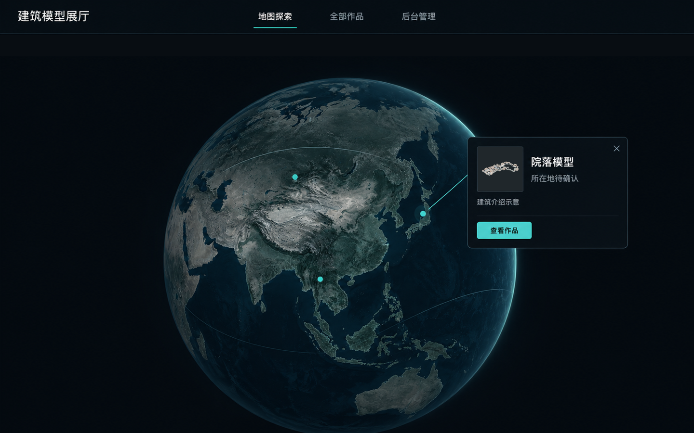
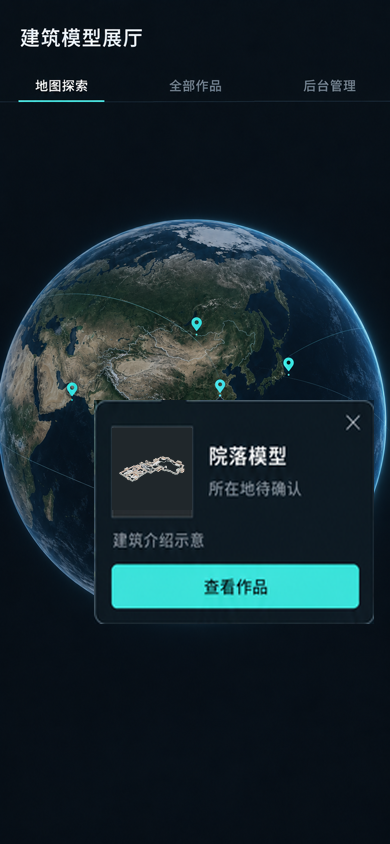
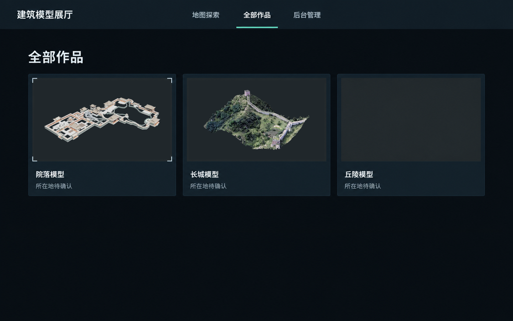
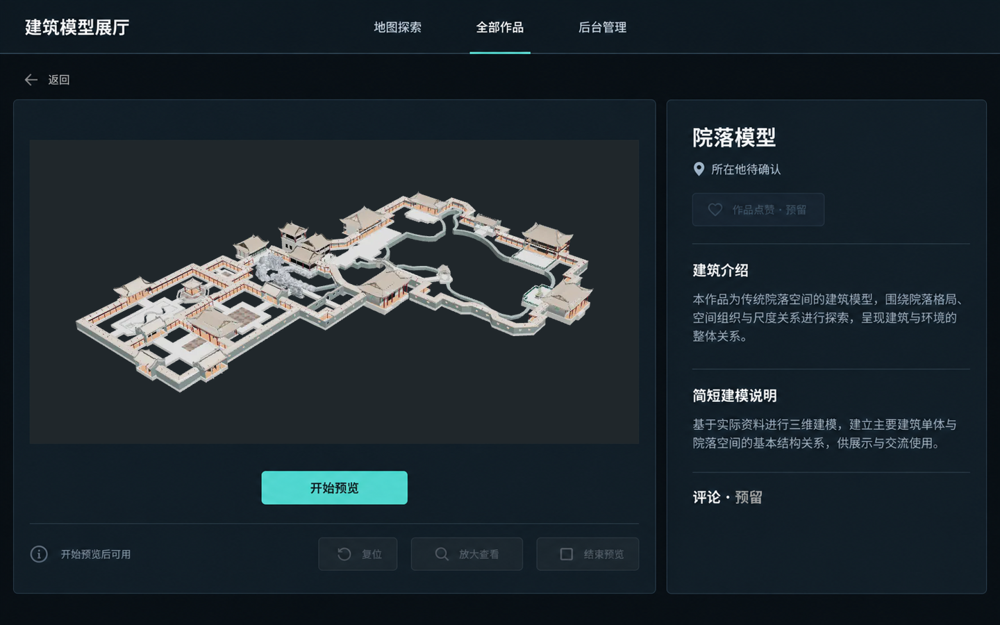
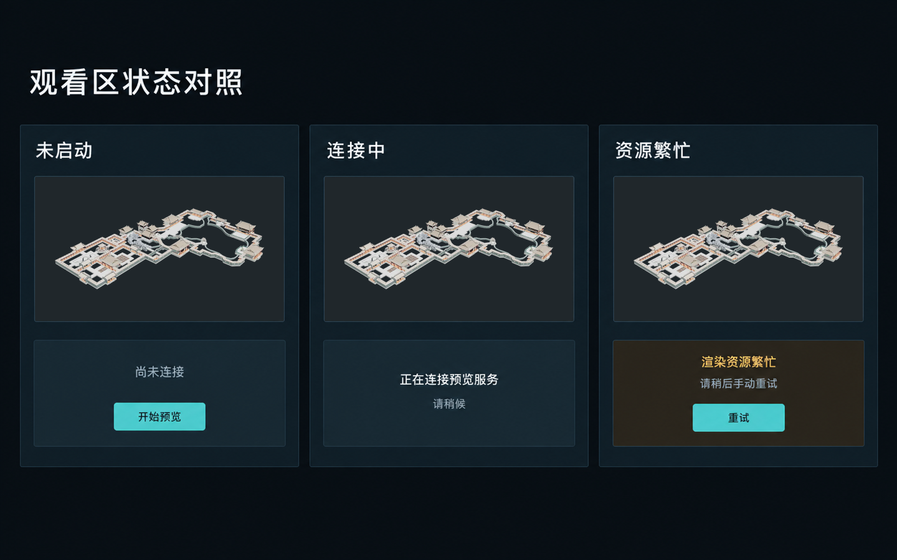
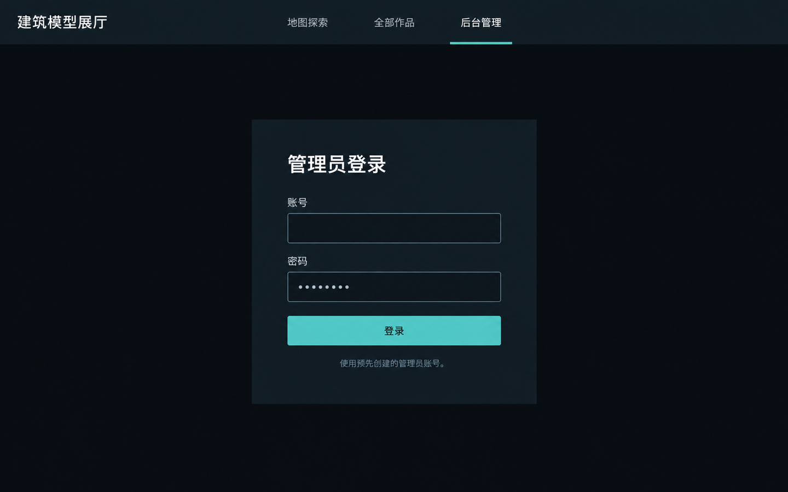
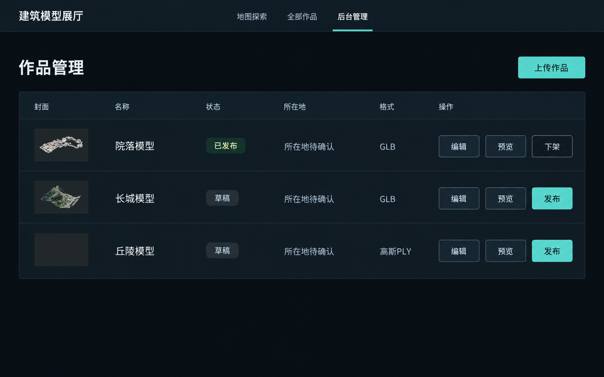
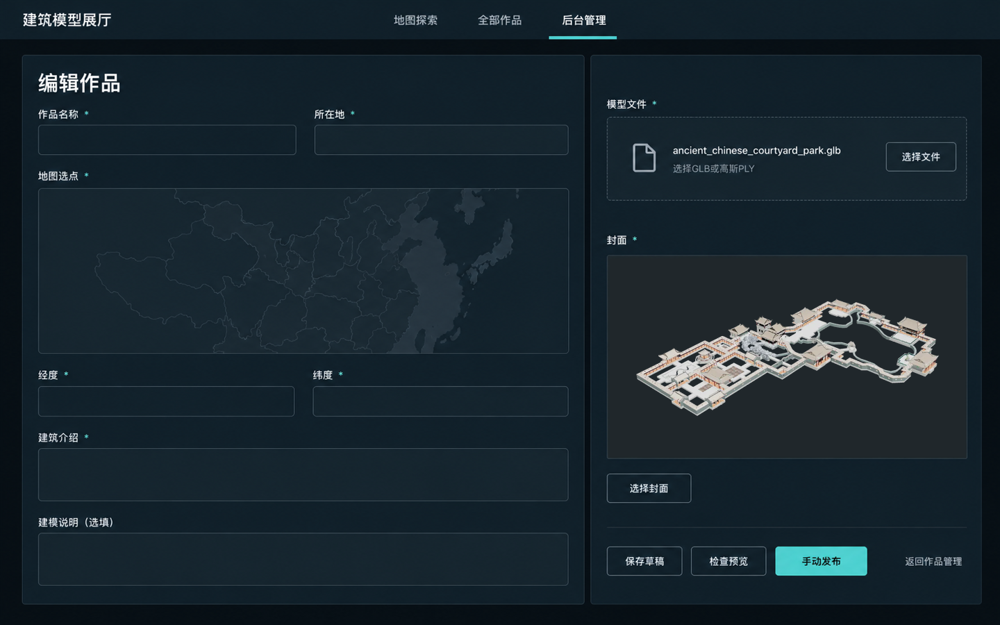
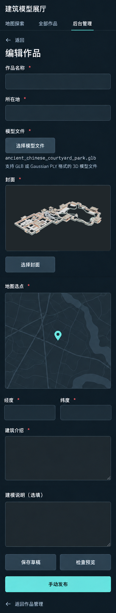

# 全页面静态参考图 · 索引与逐页自查

日期：2026-10-17  
依据：[视觉规范 v1.0（深色）](../../视觉规范v1.0（深色）.md)  
当前状态：2026-10-18 团队确定恢复采用本套深色参考图；动态效果另按 [动效设计 v1.0](../../动效设计v1.0.md) 执行。  
用途：开发前确认页面布局、氛围和信息层级。仅为静态方向参考，未制作代码或交互原型，也未修改规范。

## 2026-10-18 城市规则变更

现有图片尚未按新规则重绘，只能参考深色外观与通用版式。01／02 的单建筑气泡须改为城市标题＋同城模型列表；03／04／07 城市可空，空时正常显示“未设置城市”；08／09 删除必填所在地、地图选点和经纬度，改为标准省份＋城市选择（选填）。

未填城市模型可发布并通过全部作品进入详情，不进地球；一城多个模型只有一个点。下文逐页自查与制作过程描述的是旧图内容，不构成已取消字段的实现要求。以现行深色规范及 [城市规则](../../../工程设计/05_城市归属与地球聚合.md) 为准。

## 1. 本轮范围与处理说明

- 按提示词的编号明细交付 **9 张**：7 个桌面画面、1 个手机首页、1 个手机后台编辑长图。原提示词标题写“8 个桌面页面”，但编号明细只有 7 个桌面；本轮依明细制作，没有擅自补一个新页面。
- 桌面图均为 **1440×900**；手机首页为 **390×844**。
- 用户已明确选择手机编辑用完整长截图，因此第 9 张为 **390×2051**，包含全部字段与操作顺序，不将整页挤进 844 高的一屏。
- 页面壳与地球由内置 imagegen 制作，模型图片区始终留白；之后用本地原始封面做缩放与 alpha 合成。**院落与长城没有交给生成模型重绘，没有重新解释其几何、纹理或材质颜色。**
- 使用的真实图像是 [院落原始封面](../../原始封面/院落.webp) 与 [长城原始封面](../../原始封面/长城.webp)。现有图像仍未完成正式统一重出图流程，不将本轮合成视为出图验收。
- 丘陵保持空封面框。现有近似点云图未升级为正式高斯封面。
- “建筑模型展厅”是临时通用名称；“院落模型”“长城模型”“丘陵模型”、所在地待确认、详情正文和列表状态均用于排版，不构成正式建筑资料或后台记录。

**精确 Hex、字号、间距、控件尺寸、玻璃透明度和可访问性以规范为准。** 图片不能证明真实 CSS／字体、焦点、动效、玻璃面积、渲染性能或网络状态已经通过验收。生成式页面底稿含近似色、字形和明暗纹理，不能从图片吸色覆盖规范。

## 2. 图片索引

| 编号 | 页面 | 尺寸 | 文件 |
| --- | --- | --- | --- |
| 01 | 首页 · 桌面 | 1440×900 | [打开图片](./01_首页_桌面.png) |
| 02 | 首页 · 手机 | 390×844 | [打开图片](./02_首页_手机.png) |
| 03 | 全部作品 · 桌面 | 1440×900 | [打开图片](./03_全部作品_桌面.png) |
| 04 | 作品详情 · 桌面 | 1440×900 | [打开图片](./04_作品详情_桌面.png) |
| 05 | 观看区三状态对照 · 桌面 | 1440×900 | [打开图片](./05_观看区状态对照_桌面.png) |
| 06 | 后台登录 · 桌面 | 1440×900 | [打开图片](./06_后台登录_桌面.png) |
| 07 | 后台作品管理 · 桌面 | 1440×900 | [打开图片](./07_后台作品管理_桌面.png) |
| 08 | 后台编辑 · 桌面 | 1440×900 | [打开图片](./08_后台编辑_桌面.png) |
| 09 | 后台编辑 · 手机完整长图 | 390×2051 | [打开图片](./09_后台编辑_手机长图.png) |

## 3. 规范冲突与依据不完整之处的处理

1. **未启动详情的控制条**：页面清单要求封面、开始预览和控制条同时出现，而规范要求连接成功前不提供实际模型操作。因此图 04 将控制条置灰并写“开始预览后可用”。这里只表达位置，不暗示静态封面能旋转或复位。
2. **三种观看状态并排**：图 05 是设计对照板，不是产品新增“三会话”页面或三个 GPU 会话。后端阶段名称尚未联调，“正在连接预览服务”为文案示意，不是读取到的实时状态。
3. **手机编辑长页**：用户已选择长截图。本轮用同一页的三段连续画面合成一张长图，保留正常字段与按钮体量，并将经纬度放同一行；没有增加格式切换功能。
4. **背景地图与地球数据**：用于近似构图和氛围，非正式地图资产。示意点位和后台地图针不代表真实建筑坐标。真实地图来源、边界、坐标与材质需要后续实现选型后复核。
5. **正式名称、丘陵封面、真实介绍未齐**：使用明确占位，未悄悄当作已完成。放大查看覆盖层不在本轮页面明细内，未新增一张未要求的页面。

## 4. 逐页自查：与规范可能不一致的地方

| 编号 | 已体现的核心内容 | 仍存在的近似／偏差，评审时应注意 |
| --- | --- | --- |
| 01 | 大地球、底部轻裁、深色导航、单个点位邻近气泡、原始院落缩略图 | 地球纹理、中心位置、点位与弧线为生成近似；大气边缘仍可能偏蓝／偏亮。导航和气泡的真实透明度、模糊及 22% 面积预算未作像素验收。 |
| 02 | 实色双行导航、近完整球体的少量横向裁切、280 宽邻近气泡、原始缩略图 | 气泡局部做过尺寸对齐，字形、缩略图和按钮高度仍为近似；需按规范重新排字并保证 48 高按钮。球体与气泡的最终锚点、触摸避让和动效没有验证。 |
| 03 | 三列卡片、两张真实封面、不透明图像承托、冷银短角标 | 图像框比例、字重、间距略有偏差，部分面板带生成的明暗纹理；第三列丘陵空框表示正式封面缺失，不代表最终可发布内容。 |
| 04 | 左观看右介绍、封面与开始预览、不可用控制条、介绍／建模说明／评论与点赞预留 | 画面左右比例更接近约 2:1，信息列比规范参考的 30% 更宽；禁用条和点赞文字偏暗，不能作为对比度依据。正文为生成示例，不是已确认的建筑说明。 |
| 05 | 同一原始封面、未启动／连接中／繁忙三态、手动重试、无虚构进度 | 对照板面板有近似阴影和明暗纹理；警示块内辅助文字没有严格统一到规范语义色配对。只表达状态层级，实际仍需在正常详情观看区复核。 |
| 06 | 实色登录面板、顶部标签、账号／密码、深色字的冷青按钮 | 输入高度、面板尺寸、字重和圆角不保证精确；未展示焦点、输入法、校验错误与真实登录结果。背景明暗纹理不应照搬为玻璃或装饰效果。 |
| 07 | 缩略图／名称／状态／所在地／格式／操作表格，两张真实小图 | 行高和缩略图明显比规范示例更大；已发布文字偏黄，必须以 `#92C8AE` 为准。发布／草稿状态仅用于视觉示例，不与公开目录形成真实数据联动。 |
| 08 | 约 60/40 双列、全部既有字段、真实封面、地图与经纬度、三项底部操作 | 按钮落在右列下沿，视觉归属更偏资源列，可作为布局评审点；表单边界和地图尺寸近似。地图无真实选点，坐标空白；不代表上传、同步或发布已实现。 |
| 09 | 单列完整顺序、两列坐标、正式体量的输入与操作、原始封面、无格式切换控件 | 同页分段合成处有轻微底色／留白差别；地图占比、字号和输入高度仍非精确值。390×2051 是完整滚动内容，不是一个 390×844 视口，也不是可操作长页。 |

共性检查：最终九图没有加入搜索框、消息／头像、统计大屏、彩虹渐变、全屏粒子、假点赞数、假评论、格式切换模块或作品模型的冷青轮廓光。图中局部高亮、纹理与近似字形仍应按规范收敛；本轮只记录问题，由用户决定是否反馈到规范，不自行修改规范。

## 5. 全部页面画廊

### 01 · 首页／桌面

### 02 · 首页／手机

### 03 · 全部作品／桌面

### 04 · 作品详情／桌面

### 05 · 观看区三状态对照

### 06 · 后台登录／桌面

### 07 · 后台作品管理／桌面

### 08 · 后台编辑／桌面

### 09 · 后台编辑／手机完整长图

生成方式、最终提示词及局部修正记录见 [生成记录](./生成记录.md)。`生成底稿` 是过程文件，不作为最终页面交付索引。

