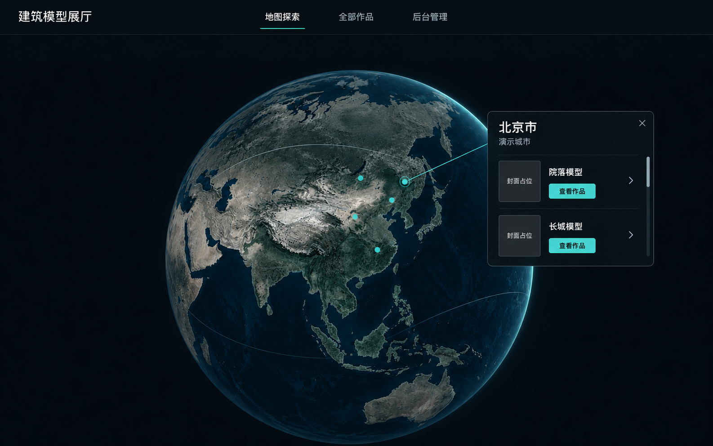
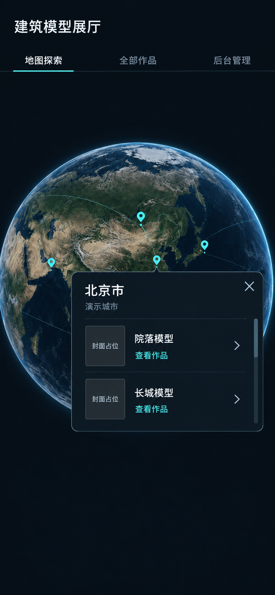
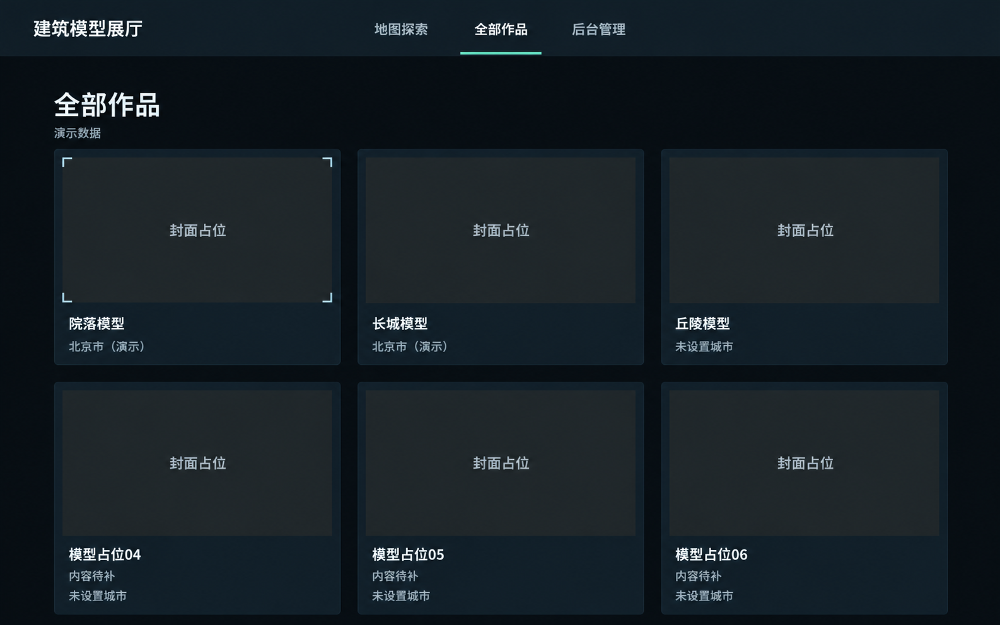
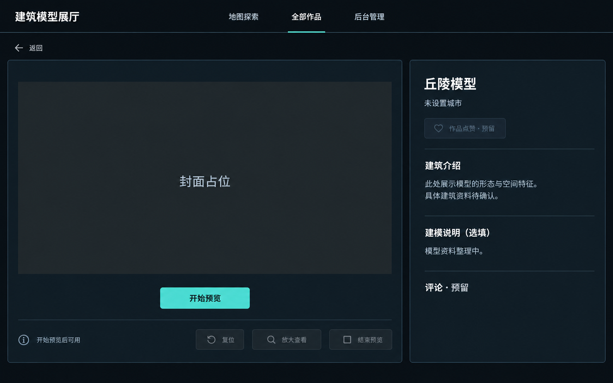
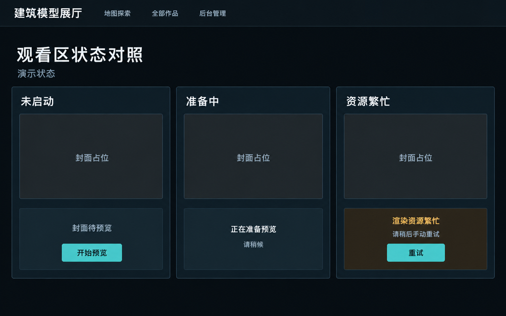
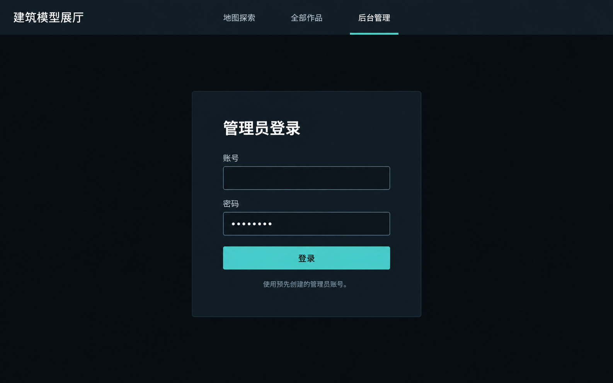
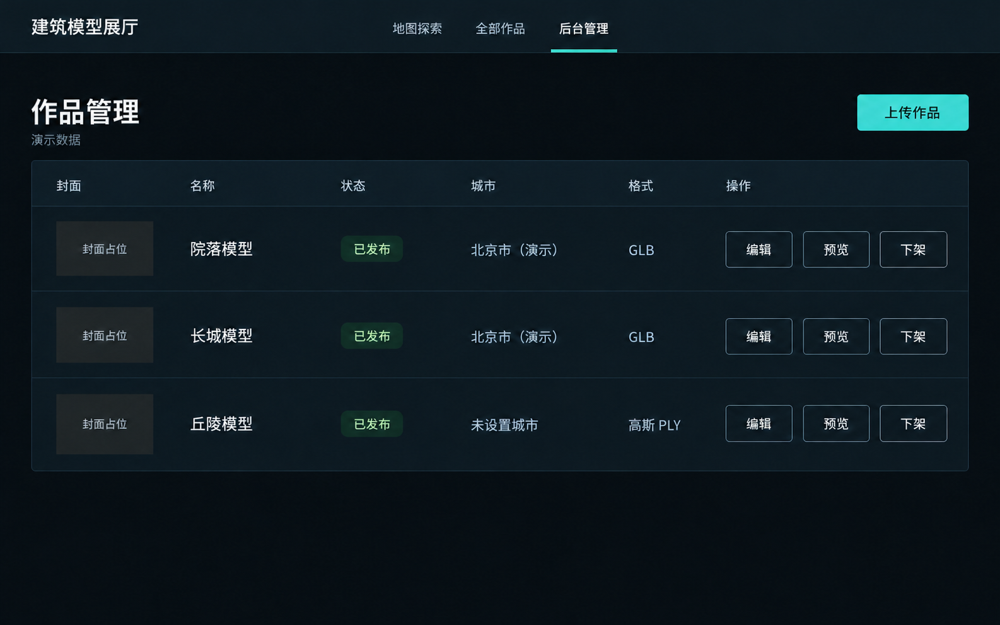
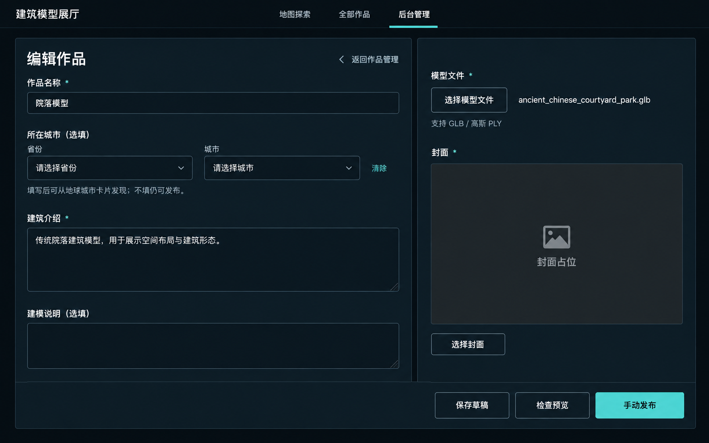
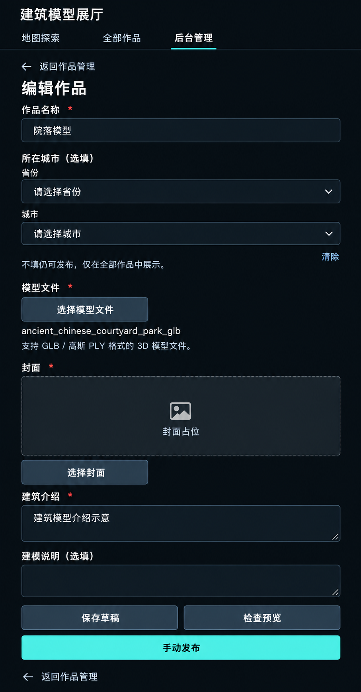

# 深色页面参考图 · 最新规划翻新版

更新：2026-10-18。状态：九张静态图已重新生成并保存，替代目录中同名旧图；尚未编写前端代码、制作动态样片或通过设备验收。

依据：[深色视觉规范](../视觉规范v1.0（深色）.md)、[动效设计](../动效设计v1.0.md)、[城市规则](../../工程设计/05_城市归属与地球聚合.md)、[最新确认记录](../../工程设计/06_已确认事项与里程碑.md)。

## 本轮已翻新的结构

- 一城一点，气泡为城市名称＋同城模型列表，点击具体模型进入详情。
- 城市选填，未设置城市的模型正常进入公开目录和详情；后台示例也可处于“已发布”。
- 编辑页改为标准省份＋城市选择及清除，移除地图选点和建筑经纬度。
- 暂用文字站名“建筑模型展厅”；AI组件未交付，全部画面隐藏其入口。
- 介绍为纯文字，未添加作者／日期、搜索、分类、分页或真实评论点赞。
- 全部模型封面使用明确“封面占位”，没有让生成模型重绘建筑并冒充正式模型素材。

“北京市／演示城市”、作品名、正文、发布状态与点位都属于排版演示，不能写入正式资料。占位可用于首次演示，不改变正式发布的模型文件、封面、名称和介绍校验。

## 图片索引

尺寸为实际生成 PNG 的原生像素，不是 CSS 尺寸。桌面按1440×900、手机首页按390×844的布局意图设计；手机编辑为完整滚动页，不强行塞进一屏。精确颜色、尺寸、手势和动效以文字规范及后续实机实现为准。

| 编号 | 页面 | 原生尺寸 | 图片 |
| --- | --- | --- | --- |
| 01 | 首页 · 桌面 | 1586×992 | [打开图片](01_首页_桌面.png) |
| 02 | 首页 · 手机 | 853×1844 | [打开图片](02_首页_手机.png) |
| 03 | 全部作品 · 桌面 | 1586×992 | [打开图片](03_全部作品_桌面.png) |
| 04 | 作品详情 · 桌面 | 1586×992 | [打开图片](04_作品详情_桌面.png) |
| 05 | 观看区状态对照 · 桌面 | 1586×992 | [打开图片](05_观看区状态对照_桌面.png) |
| 06 | 后台登录 · 桌面 | 1586×992 | [打开图片](06_后台登录_桌面.png) |
| 07 | 后台作品管理 · 桌面 | 1586×992 | [打开图片](07_后台作品管理_桌面.png) |
| 08 | 后台编辑 · 桌面 | 1586×992 | [打开图片](08_后台编辑_桌面.png) |
| 09 | 后台编辑 · 手机完整长页 | 907×1735 | [打开图片](09_后台编辑_手机长图.png) |

## 逐页检查与实现边界

| 编号 | 已体现内容及仍待验证的限制 |
| --- | --- |
| 01 | 城市标题＋同城两模型列表、逐项详情入口、冷青点位、无 AI 入口。地球纹理与点位位置仍是示意，不能作为真实城市坐标；模型同归北京市仅为演示。 |
| 02 | 双行导航、点位附近城市列表气泡、两个模型各自入口。宽度与高度为生成原生尺寸，非390 CSS像素的逐像素截图；实际手机玻璃预算、命中和滚动还需实现验证。 |
| 03 | 公开目录同时展示有城市和未设置城市模型，无分页／分类、无作者日期。首屏显示前六个布局示例，首期十件应在实现中继续向下展示；占位项不冒充真实资源。 |
| 04 | 无城市模型可正常进入详情，封面占位＋手动开始，控制条明确开始后可用，评论与点赞只预留。列宽、禁用文字对比和字号仍以规范为准。 |
| 05 | 未启动／准备中／繁忙三态、显式演示状态、无假百分比、手动重试。是设计比较板，不是三个并发会话或新增产品页面；阶段措辞待真实预览协议确定。 |
| 06 | 文字站名、预建管理员登录、账号密码与登录按钮，无 Logo、无 AI、无注册扩展。输入、焦点及认证错误需要工程实现另验。 |
| 07 | 三件样例均已发布，与城市卡片和公开目录一致；丘陵未设置城市仍已发布，操作为编辑／预览／下架。表格是演示记录，不代表真实后台状态；草稿流程通过后续实现验收。 |
| 08 | 所在城市选填、标准省市选择与清除、说明不填仍可发布；无地图或经纬度，底部统一动作栏。封面占位不等于正式上传完成；控件尺寸按规范实现。 |
| 09 | 单列全宽、选填省市、文件封面、纯文本介绍和完整底部操作，无地图／经纬度／富文本。已修正首版过大横向留白；最终控件高度和长文件名换行仍需按真实390宽实现检查。 |

所有图片均已人工视觉查看，重点检查城市选填、列表气泡、字段移除、AI入口隐藏和跨页状态一致。生成图仍存在近似字形、底纹、阴影、面板比例与色值；不能吸色替代规范，也不能用静态图宣称真实上传、预览、发布、手机手势、焦点或帧率已通过。核心复杂动画继续按独立动效文件制作，不由静态图替代。

## 全页面画廊

### 01 · 首页 · 桌面

### 02 · 首页 · 手机

### 03 · 全部作品 · 桌面

### 04 · 作品详情 · 桌面

### 05 · 观看区状态对照 · 桌面

### 06 · 后台登录 · 桌面

### 07 · 后台作品管理 · 桌面

### 08 · 后台编辑 · 桌面

### 09 · 后台编辑 · 手机完整长页

## 历史资料与生成记录

本轮生成方式、完整提示词和两次修正见 [生成记录](生成记录.md)。旧九图及旧文档保存在 [旧版归档](旧版_2026-10-17/README.md)，仅作历史比较，开发使用本页列出的当前图片。原始封面与模型文件均未修改。

