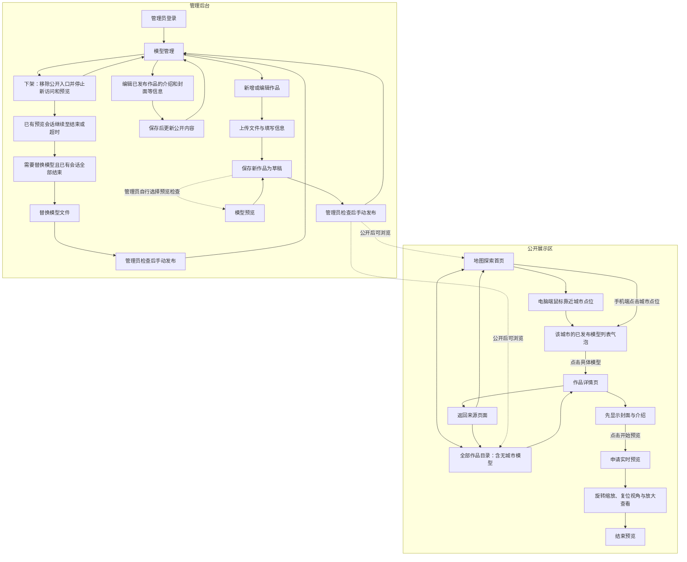
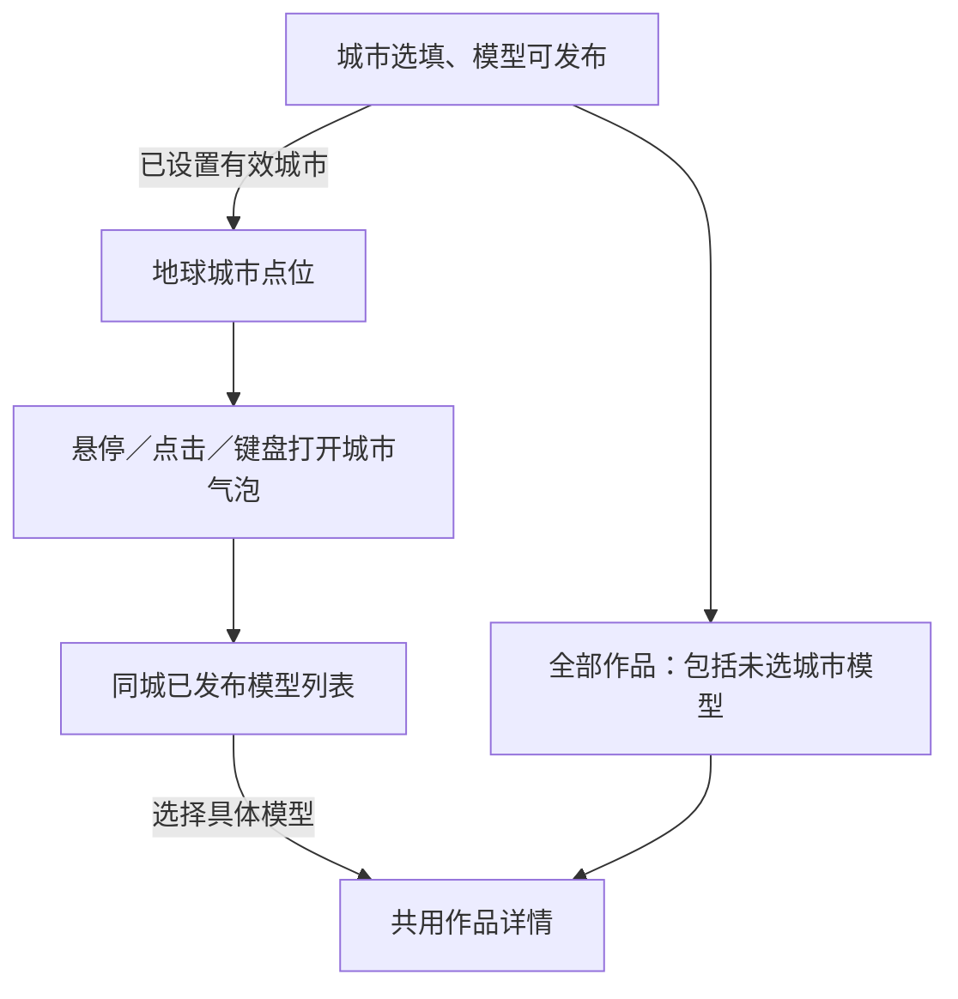
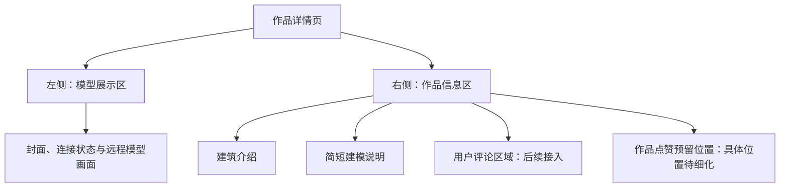
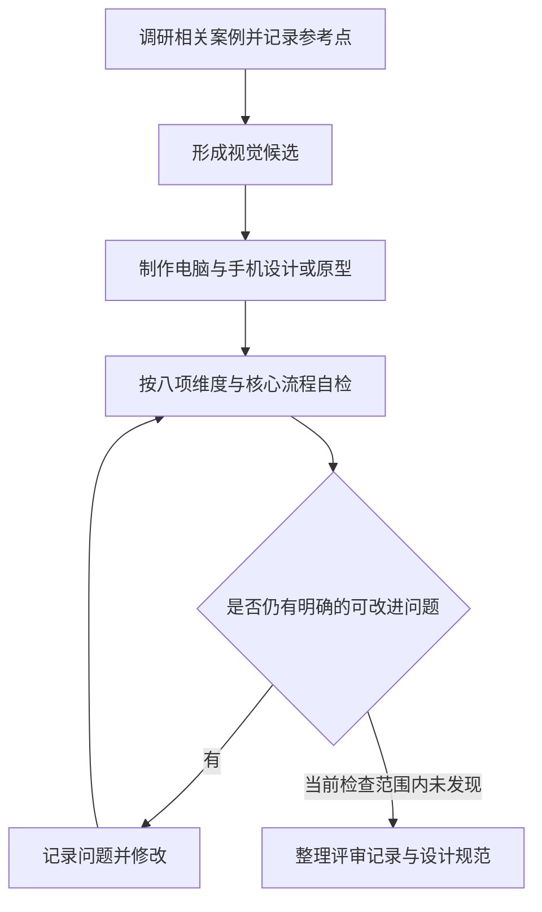
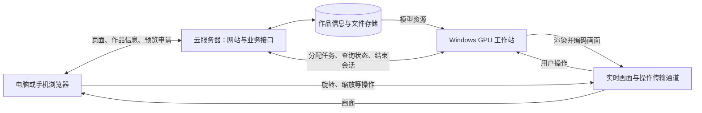
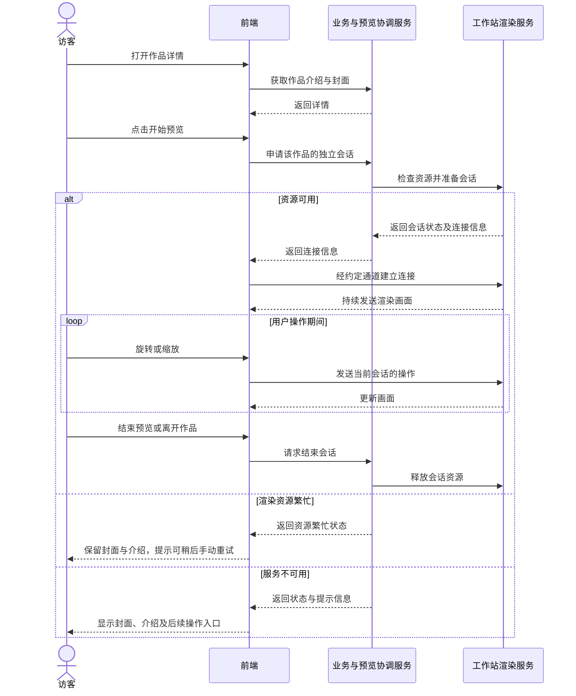
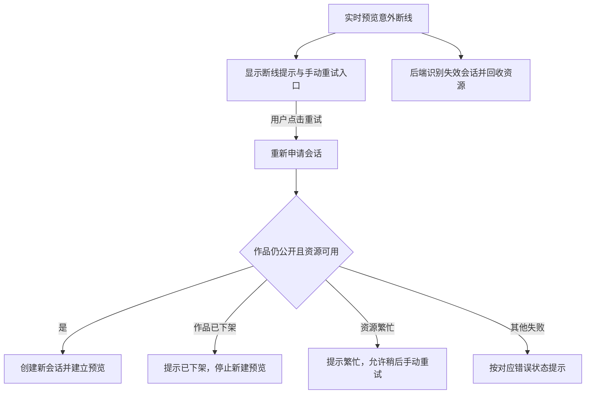
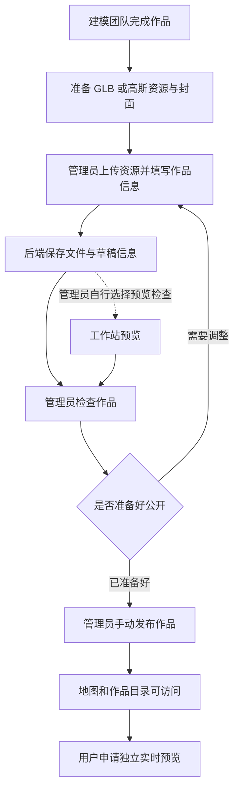
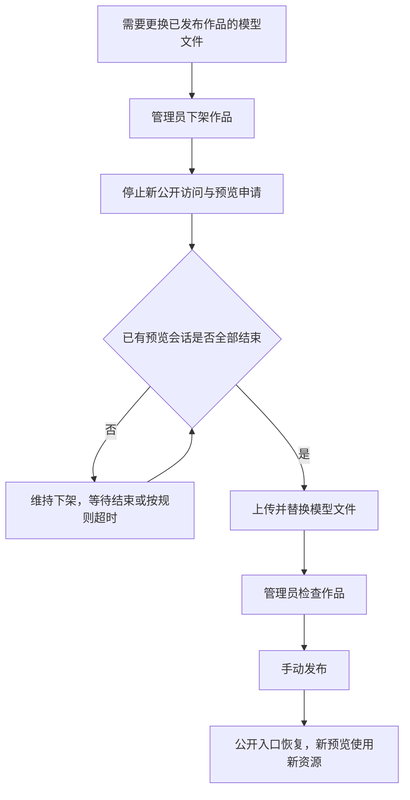
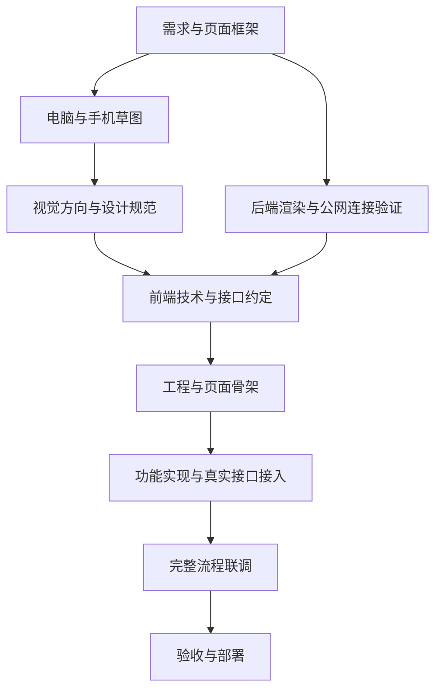

# 3D 建筑模型展示网站搭建计划

更新时间：2026-10-18  
文档状态：需求与方案整理稿，供前端、后端和建模团队共同沟通。

本文件记录当前对话中已经确定的方向、建议采用的流程，以及需要进一步确认的问题。尚未确认的方案不作为开发验收承诺。后续做出决定后，应及时更新本文件。

2026-10-18 已确认：城市选填，后台使用标准“省份＋城市”选择，取消建筑经纬度录入与地图选点。地球同城模型合并为一个点，城市气泡列出该城市已发布模型；未设置城市也可发布，只通过全部作品浏览。详见 [城市归属与地球聚合](工程设计/05_城市归属与地球聚合.md)。本规则覆盖历史原型和旧参考图的位置及气泡结构。

## 1. 项目目标与当前进度

2026-10-18 用户问题 1–15 已回答并记录于 [已确认事项与里程碑](工程设计/06_已确认事项与里程碑.md)。暂名“建筑模型展厅”，Logo 后补；2026-10-25 前首次页面动画演示，2026-11-01 前后端联调，2026-11-18 前最终交付；首次演示可用明确 Mock 和占位。AI 助手仅公开端挂载，未交付先隐藏；流畅度优先。

2026-10-18 AI 助手协作更新：当前按 AI 负责人交付完整组件规划，主站只负责引入、配置、挂载／卸载及深色与手机页面适配；聊天面板、消息、会话、服务接入、失败反馈与内部动画由组件负责。具体包／脚本形式、配置和交付时间待对接，不视为组件已交付或服务已联通。

网站用于保存团队完成的建筑模型，并向公众提供按地理位置探索、浏览作品及交互查看模型的体验。首期 10 个模型，仅国内；现有院落、长城、丘陵可作开发样例，其余内容逐步补齐。

用户负责前端功能实现与 UI 设计，后端由其他成员负责。前端需要提前与后端约定接口，能够在后端尚未完成时通过模拟数据推进页面工作。

当前工作目录尚无前端工程。已完成需求讨论、初版结构草图，以及包含公开端和后台的双端交互原型与两套视觉候选。原型用已发布的地理边界绘制示例地图，业务数据、建筑画面和后台操作均为演示；已选 React + TypeScript + Vite 与 GSAP，确切依赖版本在初始化时锁定，尚未接入正式地图服务、模型渲染或画面传输服务，也没有渲染性能与多人并发的验证结果。

2026-10-18 最新视觉进度：团队确定整体 UI 使用 [深色视觉规范 v1.0](UI设计/视觉规范v1.0（深色）.md)：极简暗底、局部深色玻璃、冷青操作与冷银角标。公开端、后台与手机统一执行；[深色九图](UI设计/页面参考图_深色/索引与逐页自查.md) 已按城市选填、城市模型列表和新编辑表单翻新，复杂动画按 [动效设计 v1.0](UI设计/动效设计v1.0.md) 在页面骨架阶段制作。当前仍未新增工程代码，真实内容与设备验收待完成。

## 2. 已确定的方向

| 事项 | 当前决定 | 说明 |
| --- | --- | --- |
| 网站组成 | 公开展示区＋管理后台 | 访客浏览作品，团队成员登录后维护作品 |
| 首期作品数量 | 10 个 | 现有三个可作开发样例；不足部分演示时明确占位，后续补齐真实资源 |
| 交付节点 | 10 月 25 日前演示、11 月 1 日前联调、11 月 18 日前最终交付 | 从 2026-10-18 起算；第一次只要求页面与动画可展示，真实接入随后完成 |
| 主要探索方式 | 城市位置＋全部作品 | 地球按城市聚合；无城市已发布模型仅经全部作品浏览 |
| 电脑地图交互 | 鼠标靠近城市点位弹出气泡 | 显示城市名和该城市已发布模型列表，点击具体模型进入详情 |
| 手机地图交互 | 点击城市点位，在附近显示城市模型列表气泡 | 多项内部滚动，边缘避让，关闭与模型入口完整可用 |
| 首期地理主视觉 | 三维地球，可拖拽旋转 | 2026-10-17 已确认，覆盖早期二维地图假设；具体交互规格与地图工具仍待确定 |
| 另一个浏览入口 | 全部作品目录 | 使用作品卡片进入详情，与地图共用作品数据和详情页 |
| 搜索 | 首期暂不实现 | 先通过地图标记和作品目录浏览 |
| 模型交互 | 旋转、缩放、复位视角、放大查看 | 复位回到默认视角，放大用于展开模型展示区域；具体手势与布局待细化 |
| 预览启动方式 | 先显示封面，点击“开始预览”后连接 | 打开详情页仅获取作品信息与封面；点击后才申请 GPU 渲染会话 |
| 渲染资源占满 | 提示繁忙，允许稍后手动重试 | 首期不进入等待队列，也不在资源空闲后自动启动预览 |
| 电脑详情页布局 | 左侧模型展示，右侧介绍信息与用户评论区域 | 左右占比、评论区域呈现方式待草图细化 |
| 介绍内容 | 建筑介绍＋选填建模说明，纯文字支持换行 | 不加作者／团队与制作日期，不做富文本；AI 基于模型辅助整理，未知事实不推断 |
| 用户评论 | 在详情页预留区域与接口需求 | 首期先按预留理解，实际评论数据与发表功能后续接入 |
| 作品点赞 | 点赞对象为模型作品 | 预留作品点赞与取消点赞能力，评论点赞尚未纳入需求 |
| 终端支持 | 电脑和手机主流浏览器 | 不含微信内置浏览器；公开端和后台均适配，具体设备版本联调登记，流畅度优先 |
| 后台核心功能 | 登录、上传、编辑信息、预览、发布、下架 | 具体表单字段、权限规则与发布条件待确认 |
| 管理员账号与权限 | 后端预先创建账号，管理员均可管理全部作品 | 首期采用统一管理员权限；认证方式、账号交付及登录失效规则待前后端约定 |
| 新作品公开流程 | 先保存为草稿，管理员检查后手动发布 | 上传或保存草稿本身不会使作品公开 |
| 发布前预览检查 | 管理员自行检查 | 系统不强制验证成功预览记录；发布必填内容已确定，上传完整性校验细节待约定 |
| 草稿与发布校验 | 草稿允许资料不完整，发布前补齐必填内容 | 模型文件、名称、封面、建筑介绍必填；城市与简短建模说明选填 |
| 后台位置录入 | 标准省份＋城市选择，城市选填 | 后端字典提供城市中心，不录入建筑坐标；未填可发布且只经目录浏览 |
| 已发布作品的信息修改 | 修改介绍、封面等信息并保存后，直接更新公开内容 | 首期不为此增加单独的修改稿发布步骤；模型文件替换按独立流程处理 |
| 下架行为 | 移除公开地图与目录入口，停止新的公开访问和预览申请 | 已有预览会话继续，直到用户结束或按规则超时；会话超时规则仍待确定 |
| 模型文件替换 | 先下架，等已有预览结束后替换，检查后再手动发布 | 等待期间维持下架状态；检查由管理员自行完成，不强制验证成功预览记录 |
| 预览断线恢复 | 提示断线，用户手动重试并重新申请会话 | 首期不自动重连；旧会话需释放，重新申请时重新检查作品状态和资源容量 |
| 模型格式 | GLB 与高斯 PLY | PLY 已确认是 3D Gaussian Splatting 结果 |
| 两种格式的关系 | 不同作品分别使用 | 首期不围绕同一作品的两种格式切换设计 |
| 原始文件大小 | 几十到几百 MB | 文件大小不能直接推导运行时显存占用和帧率 |
| 展示资源准备 | 建模团队先处理 | 网站接收团队准备的资源；首期尚未约定服务端自动转换流程 |
| 渲染方向 | 工作站实时渲染，客户端展示画面 | 目标是降低访客设备承担的模型渲染负担 |
| 首期渲染设备 | 带 NVIDIA GPU 的移动工作站 | RTX 5050、RTX 5060 等为候选，具体设备尚未确认 |
| 工作站系统 | Windows | 与云服务器的 Ubuntu 系统分开部署 |
| 多人目标 | 2–3 人同时独立操作 | 各自的模型和相机状态应隔离；这是待验证目标，不是现有容量结论 |
| 下载 | 后续允许下载，首期暂不实现 | 在接口协作中记录下载能力，不提前承诺具体下载接口或按钮 |
| 后续部署 | 可以替换为 GPU 服务器或其他方案 | 提前约定预览服务边界，降低页面迁移成本 |
| 视觉倾向 | 极简暗色、局部深色玻璃、冷青强调与冷银角标，三维内容为中心 | 2026-10-18 团队确定采用深色 v1.0；尺寸、材质和圆角按规范，复杂动画按独立动效设计 |
| UI 品质要求 | 以 Awwwards、Webby Awards、FWA 获奖级网站为品质参照，减少模板感与 AI 味道 | 从排版、留白、视觉层级、色彩、动效、微交互、响应式、原创性持续自检与优化；详见 5.3 |

网站暂用“建筑模型展厅”，Logo 后补；AI 助手由其他成员提供完整组件，仅公开端挂载，未交付时隐藏入口。全部作品和城市模型列表按发布时间降序、id 稳定排序，一次展示全部，不分页分类。

参考图中的旅游路线、打卡、消息、社交动态等内容尚未纳入已确定的功能范围。它们不构成本项目的默认需求。

## 3. 现有硬件与部署分工

### 3.1 已有云服务器

| 项目 | 配置 |
| --- | --- |
| 类型 | 轻量应用服务器，锐驰型 |
| CPU / 系统内存 | 4 核 / 8 GB |
| 系统盘 | 120 GB SSD 云硬盘 |
| 带宽 | 200 Mbps 峰值带宽 |
| 地域 | 北京 |
| 操作系统 | Ubuntu 24.04 LTS |
| GPU | 提供的配置中未列出，尚未进一步核实 |

首期按该服务器承载网站页面、管理接口、作品信息、文件存储及预览协调服务来规划。存储是否独立使用对象存储、数据库如何部署、中继是否使用该服务器，都需要后端进一步确认。

### 3.2 GPU 工作站

工作站负责加载 GLB / 高斯资源、计算用户视角、渲染、编码和发送画面。GLB 和高斯 PLY 的具体加载及渲染实现由后端团队验证。前端通过统一的预览服务约定接入，不直接依赖工作站的固定地址或某个具体渲染器。

需要核实具体 GPU、显存、系统内存、驱动、渲染软件环境、持续供电和联网条件。工作站上行网络也会影响远程预览，不能只依据云服务器的峰值带宽判断效果。

## 4. 页面与导航框架

### 4.1 公开展示区

| 页面 / 区域 | 核心内容 | 主要操作 |
| --- | --- | --- |
| 地图探索首页 | 三维地球、城市中心标记 | 电脑悬停／手机点击城市点位，附近显示城市模型列表气泡 |
| 城市卡片 | 城市名、同城已发布模型的封面与名称列表 | 每件模型一个详情入口，只有一个模型时结构相同 |
| 全部作品 | 所有已发布模型的封面、名称、城市或“未设置城市” | 有无城市都可进入详情；最新发布优先，一次展示全部，不分页分类 |
| 作品详情 | 左侧远程模型展示，右侧建筑与作品介绍、评论预留区；作品点赞预留位置 | 启动预览、旋转缩放、复位视角、放大查看、结束预览、返回来源页面；评论与点赞后续接入 |

地图入口与作品目录使用同一作品编号进入同一详情页。具体路由地址尚未确定。

### 4.2 管理后台

| 页面 | 核心内容 | 主要操作 |
| --- | --- | --- |
| 管理员登录 | 登录表单与错误提示 | 登录，失效后重新登录 |
| 模型管理 | 作品列表、封面、发布状态 | 新增、编辑、预览、发布、下架 |
| 新增 / 编辑作品 | 文件、封面、基本信息、地理位置 | 上传、保存、检查预览效果 |

管理员账号由后端预先创建，管理员具有相同的作品管理权限，可管理全部作品。首期登录页对接这些账号；具体认证和账号交付方式由后端提供并与前端协商。

新增与编辑建议复用表单。管理员预览建议复用公开端的预览服务能力，是否占用同一渲染资源池需要与后端确认。

已确认的新作品流程为：上传文件与填写信息 → 保存草稿 → 管理员检查 → 手动发布。草稿由后台维护，公开地图、目录和详情仅按发布规则提供已发布作品。已发布作品修改介绍、封面等信息，保存成功后更新公开页面；具体缓存刷新方式需与后端约定。

发布前预览由管理员自行检查，系统不以成功预览记录作为发布条件。草稿允许资料不完整，发布时校验模型文件、名称、封面、建筑介绍；城市与简短建模说明选填。城市通过标准省市选择，未填仍可发布；不提供建筑选点地图或经纬度输入。

下架后停止新的公开访问与预览申请，已有预览会话继续至结束或按规则超时。更换模型文件时先下架，等待已有预览结束，再替换文件、检查并手动发布；超时、资源缓存更新与替换失败处理仍需细化。

### 4.3 网站页面流程图

### 4.4 首期页面与状态交付清单

以下清单将已确认功能落实到页面，供原型、前端开发和联调逐项使用。具体路由与组件拆分在工程方案确定后补充。

| 页面 | 必须体现的内容与行为 | 需要呈现的状态 |
| --- | --- | --- |
| 地图探索 | 城市点位、城市模型列表气泡、选择具体模型进详情、前往目录 | 加载中、有城市、无城市但目录有模型、无公开模型、读取失败 |
| 全部作品 | 约 10 件首期作品的封面、名称与所在地，进入共用详情页 | 加载中、正常、空目录、读取失败 |
| 作品详情 | 左模型右信息、建筑介绍、选填建模说明、评论与点赞预留、手动启动预览、四项模型操作 | 封面、连接准备、预览中、资源繁忙、工作站不可用、断线、作品不存在或已下架 |
| 管理员登录 | 登录、错误反馈、成功后进入管理区 | 待输入、提交中、凭据错误、网络失败、登录状态失效 |
| 模型管理 | 查看作品与状态，新增、编辑、预览、发布和下架 | 加载中、空列表、正常、操作进行中、操作失败 |
| 新增／编辑 | 按 7.2 分组录入、选填城市、上传、保存与发布 | 未完成草稿、上传中、上传失败、保存中、字段校验失败、保存或发布成功 |

公开作品详情和管理员预览共用展示能力，后台需要具备查看草稿等未公开作品的授权入口。具体复用页面还是独立预览路由由工程方案确定。

每个页面都需在电脑和手机布局中检查。设计稿应展示正常状态及主要失败状态；预留功能采用明确的未接入状态。真实功能状态与原型演示状态分别记录。

## 5. 电脑与手机的布局要求

以下是已讨论的布局建议，仍需通过草图评审定稿。

| 区域 | 电脑布局方向 | 手机布局方向 |
| --- | --- | --- |
| 导航 | 网站标识＋地图探索、全部作品 | 紧凑导航，两个入口均清晰可达 |
| 地图与卡片 | 鼠标靠近城市点位显示同城模型列表气泡 | 点击城市点位打开，列表可滚动、入口完整 |
| 作品目录 | 多列封面卡片 | 根据实际可读宽度调整列数与卡片尺寸 |
| 作品详情 | 左侧模型展示，右侧介绍与评论预留区，安排作品点赞预留位置 | 模型、介绍、评论依次纵向排列，提供放大查看方式；点赞入口位置待细化 |
| 后台列表 | 列表或表格 | 适合触摸的作品卡片或重排后的列表 |
| 后台表单 | 可安排表单与预览并排 | 分区纵向排列，完整支持上传、编辑和发布操作 |

响应式验收需要覆盖导航、表单、地图操作和远程预览；手机端的关键操作应当直接可见、便于触摸。地图、预览手势与页面滚动之间的关系应在原型阶段确认。全屏或放大查看的具体实现需要适配目标浏览器。

### 5.1 城市气泡卡片交互

地球每座城市一个点，中心由后端标准城市字典提供。同城已发布模型在该城市气泡中列出；城市为空的模型不参与地球聚合，仍在全部作品中正常展示和进入详情。

电脑悬停城市点位、手机点击或键盘聚焦时在点位附近打开气泡。气泡包含城市名和每件模型的封面、名称及详情入口；一个模型时也使用相同结构。列表多项时内部纵向滚动，关闭操作可达，边缘不裁内容。

从点位移入气泡保持打开，离开且无键盘焦点后再收起。城市标题不直接跳某个模型；用户选择具体模型才进入详情并按需启动预览。背面与相邻城市的命中和镜头接管沿用视觉及动效规范。

城市数据读取失败可手动重试。没有城市点但仍有已发布模型时提示前往全部作品，不能显示“暂无作品”。更改或清空模型城市、下架城市最后一个模型后刷新相关列表与点位。

### 5.2 作品详情页与互动能力预留

已确认的电脑端布局方向：左侧用于展示模型，右侧放置模型介绍信息及用户评论区域。点赞对象已确认为模型作品。页面沿用现有的远程预览流程，地图与全部作品入口共用这一详情页。

首期按“预留区域与接口需求”推进评论和作品点赞；实际评论展示、发表、点赞写入等功能在接口及规则明确后接入。当前规划不代表后端已经提供这些能力。

- 左侧模型展示区覆盖封面、准备连接、正在预览、繁忙、离线等状态，并承载鼠标或触摸操作。
- 已确认提供旋转、缩放、复位视角与放大查看。复位使用该作品约定的默认视角；放大查看用于展开模型展示区域，具体布局及退出方式待原型确认，不预先限定为浏览器全屏。
- 建议放大及恢复布局时沿用当前预览会话，保持模型视角与连接；显示尺寸变化与操作坐标如何同步，需前后端共同约定。
- 已确认先展示封面与“开始预览”入口，用户点击后才申请 GPU 渲染会话；单纯查看介绍或评论区域不会创建渲染会话。
- 已确认资源占满时保留封面和介绍，显示繁忙提示及手动重试入口；用户点击重试后重新申请会话，首期不提供排队或自动接入。
- 已确认意外断线后显示中断提示，由用户手动重试并重新申请会话；首期不自动重连，申请时重新校验作品是否公开和渲染资源是否可用。
- 右侧安排建筑及作品介绍、评论区域；介绍与评论采用上下排列还是分区切换，待草图评审确定。
- 介绍内容已确定包含“建筑介绍”和“简短建模说明”两部分，其中建筑介绍发布时必填，简短建模说明选填。建筑背景、制作方式等具体内容和字数要求待细化。
- 作品点赞预留在作品信息或相关操作区，具体按钮位置待确认；后续需要支持点赞数量、本人点赞状态，以及点赞和取消点赞。
- 手机端建议按模型展示、介绍、评论的顺序纵向组织，保留完整查看入口；屏幕空间与操作手势需要一起设计。
- 评论与点赞属于作品业务接口，由业务后端提供；读取评论或点赞不应额外申请模型渲染会话。
- 原型或开发中若使用示例评论、示例计数，应明确标为模拟内容。未接入接口时展示功能预留状态，避免将未取得的数据呈现为真实评论或真实计数。

该图表达电脑端区域归属，具体尺寸与布局以草图为准。评论账号身份、评论字段、展示顺序、发表和删除规则、点赞身份及重复请求的处理，需与后端另行约定。

### 5.3 UI 品质目标、自检与迭代

用户明确要求：以 Awwwards、Webby Awards、FWA 获奖级网站为品质标准，完成后从排版、留白、视觉层级、色彩、动效、微交互、响应式和原创性上自检并持续优化，直到没有明显可提升之处，减少 AI 味道。

此要求贯穿后续视觉设计、前端实现和验收。获奖案例用于研究设计质量和表达方法，具体视觉方案需结合建筑模型展厅的内容与操作流程形成。

#### 设计参考与表达原则

- 调研建筑、文化展览、地理探索与交互展示相关案例，记录具体参考点及来源；称为获奖案例时，应核对官方记录。
- 围绕中国地图、城市点位、气泡预览和模型观看建立视觉表达，用真实建筑封面、模型截图和内容支撑主要画面。
- 探索少量有明确差异的视觉候选，差异应体现在版式、图像组织、字体与交互表达上，再细化选定方向。
- 建立统一的中文字体层级、间距、色彩、图标、按钮与状态规则，覆盖公开页面和管理后台。
- 渐变、毛玻璃、发光、圆角与装饰元素根据内容和操作需要使用，控制重复密度与强度，保持文字、地图和模型画面清晰。
- 文案使用具体的建筑、作品与操作信息；模拟内容清楚标识，不虚构评论、点赞数、项目指标或用户评价。
- 动效帮助用户理解选中、展开、连接和返回等变化，支持减少动态效果的使用偏好，并关注真实设备的操作表现。

#### 八项自检清单

| 维度 | 本项目重点检查 |
| --- | --- |
| 排版 | 中文标题、正文、所在地与辅助信息的层级是否明确；长建筑名称、长介绍的换行与行长是否自然 |
| 留白 | 导航、气泡、模型区、介绍区、评论预留区与表单分组的间距是否有节奏；各屏幕下是否过密或出现无意义空白 |
| 视觉层级 | 地图、选中建筑、查看作品与开始预览等当前任务是否容易识别；主次操作是否清晰 |
| 色彩 | 配色是否统一并呼应建筑内容；地图和模型背景上的文字、按钮与状态是否清晰可辨 |
| 动效 | 气泡出现与收起、页面切换、放大与恢复是否连贯；是否出现抖动、跳动、遮挡或影响操作的效果 |
| 微交互 | 鼠标靠近、选中、点击、键盘焦点、触摸、上传、保存与失败提示是否有准确反馈；气泡能否稳定移入并点击 |
| 响应式 | 电脑、手机及中间宽度布局是否自然；点位附近的气泡、长内容、评论预留区和后台表单是否完整可用 |
| 原创性 | 是否具有建筑模型展厅自身的内容和交互特征；图像、版式和细节是否经过针对性设计，整体是否存在明显套版感 |

八项自检还需与功能验收一起进行，覆盖内容、导航、加载、失败与离线等状态。作为参考，[Webby 官方网站评审标准](https://www.webbyawards.com/judging-criteria/)也包含内容、结构与导航、视觉设计、功能、交互、创新和整体体验。

#### 评审与优化流程

每轮记录检查页面、设备或尺寸、具体问题、修改内容与复查结果；通过真实尺寸的画面和实际操作检查上述维度。优先修复影响阅读与操作的问题，再调整版式、视觉表达与细节。

阶段完成时，应修复当前检查范围内可识别的明显问题，列明尚未覆盖的页面、状态或设备。涉及主观风格的取舍应通过候选方案和评审沟通确定，不以主观评分替代具体问题记录。新增内容、功能和尺寸后继续复查。

#### 当前评审反馈与精修方向（2026-10-17）

**当前设计依据：2026-10-18 团队确定使用 [深色视觉规范 v1.0](UI设计/视觉规范v1.0（深色）.md) 与 [复杂动效设计](UI设计/动效设计v1.0.md)。** 三维地球、空间层次与局部深色玻璃为主线，配色、字体、尺寸、材质与圆角统一执行深色规范。首页空间入场、点位与镜头联动、封面进入详情的连续转场均纳入首期，在页面骨架阶段制作样片。图片与文字冲突时以文字为准，具体布局参考 [深色页面索引](UI设计/页面参考图_深色/索引与逐页自查.md)。此前“建筑档案”精修版仅作历史交互参考。

用户已认可交互逻辑大体符合预期，但认为上一版界面“AI 味太浓，缺乏高级感”。这表示交互框架可作为后续基础，上一版视觉不作为最终设计。

此前一轮曾探索建筑档案与展览图录方向；其中有价值的内容组织经验保留为历史参考。当前字体、色板、材质与圆角采用深色 v1.0，动态表现采用复杂动效设计，不重新开启候选风格选择。

“建筑档案”为历史临时展示名称，当前暂用“建筑模型展厅”，Logo 后补；深色展示方向已经确定。后续结合真实作品和具体页面优化，不将“高级感”换算为虚构评分。

## 6. 实时预览的系统架构

当前方向为远程实时渲染：客户端发送操作，工作站产生新视角画面并传回。客户端需要播放画面，并维持与服务端的操作和状态通信。

此前讨论过的浏览器分别加载 GLB 与高斯 PLY 的方案，不再作为当前首期预览方案。两类资源的渲染差异主要由工作站服务处理。

### 6.1 逻辑架构图

这是逻辑架构，不代表浏览器一定能直接连接工作站。WebRTC 可作为候选传输方式；具体协议、连接协商、公网访问和中继方案需要后端验证后确定。

### 6.2 建议的预览会话流程

离开页面时的结束请求可能因断网或浏览器关闭而丢失，后端需要有会话失效与资源回收机制。断线后的恢复方式已确定为用户手动重试并新建会话，不恢复原会话；具体断线识别、心跳和超时回收时长待协商。

### 6.3 详情页需考虑的状态

| 状态 | 界面意图 | 待细化内容 |
| --- | --- | --- |
| 未启动 | 展示封面、介绍及开始预览入口 | 已确认由用户点击启动；按钮样式与说明文案待细化 |
| 连接 / 模型准备中 | 告知当前阶段，避免无反馈等待 | 阶段状态与真实进度由后端提供，不能编造百分比 |
| 预览中 | 播放画面，支持旋转、缩放、复位视角和放大查看 | 具体手势、默认视角、放大布局与显示尺寸同步方式 |
| 渲染资源繁忙 | 保留封面和介绍，提示繁忙并提供手动重试入口 | 已确定首期不排队、不自动接入；具体提示文案待细化 |
| 工作站离线 | 保留封面与作品介绍 | 提示文案、恢复后的操作 |
| 连接中断 | 提示断线，提供手动重试入口；重新申请会话 | 不自动重连已确定；断线识别、旧会话回收和提示文案待细化 |
| 正常结束 | 返回封面或来源页面 | 返回时保留地图位置、选择及目录位置，建议实现 |

### 6.4 断线后的恢复流程

断线后重试属于新的预览申请，需要重新检查作品状态与资源容量。若作品已下架，不能借助旧会话恢复预览；若资源繁忙，按已有规则提示并由用户稍后重试。后端应对失效旧会话执行回收，具体时长与前端结束请求配合方式待约定。

## 7. 模型资源与发布流程

作品资源按用途考虑：原始成果用于归档和后续下载；展示资源用于工作站加载与渲染；封面用于地图、目录及启动预览前的展示。原始文件满足展示要求时可以复用，不要求每件作品都保存重复文件。

既然当前采用远程渲染，展示资源应优先满足工作站加载、渲染质量与多人运行要求。是否需要降面、压缩、裁剪或其他优化，通过真实样例决定。高斯 PLY 与普通网格的处理方式分别验证。

新作品先保存草稿、管理员检查后手动发布，以及已发布作品的信息修改保存后直接更新，均已确认。预览检查由管理员自行完成，系统不强制验证成功预览记录。模型文件替换遵循下架、等待已有预览结束、替换、检查后手动发布的流程；上传中断处理仍待确定。

### 7.1 已确认的发布与编辑规则

- 新作品上传和保存后为草稿，管理员检查后主动点击发布；保存草稿与发布是两个操作。
- 草稿阶段可以继续修改资料，并通过约定的管理预览能力检查模型。
- 管理员自行决定并完成预览检查，发布接口不要求成功预览记录。工作站暂时不可用本身不应成为发布阻断条件；发布必填内容按下一节执行，上传完整性与资源有效性校验细节需与后端约定。
- 已发布作品的介绍、封面等信息保存成功后更新公开内容，不要求再次执行发布操作。更新的缓存与刷新行为由接口和前端约定。
- 模型文件替换采用独立流程：先下架，等已有预览结束后替换文件，管理员检查后再手动发布。发布前预览仍由管理员自行检查，系统不强制验证成功预览记录。
- 下架后作品从公开地图和目录移除，新的公开详情访问及预览申请停止提供；通过旧卡片或链接访问时需提示作品已下架。
- 下架不会立即终止已经建立的预览会话；会话继续至用户结束或按规则超时。已打开详情但尚未启动预览的访客，不属于已有预览会话，后续申请应按下架状态处理。
- 下架后意外断线的预览不能重新申请新会话；已有会话维持至结束或超时的规则仍适用。具体断线识别与超时规则待约定。

### 7.2 上传／编辑表单与发布校验

草稿允许先保存不完整资料，发布时再校验必填内容。下表记录已确认的首期字段范围及发布要求；字段长度、文件限制和接口格式仍需前后端细化。

| 分组 | 字段 | 发布时要求 | 用途 |
| --- | --- | --- | --- |
| 模型资源 | 模型文件（GLB 或高斯 PLY） | 必填，资源须已上传完成 | 工作站加载和渲染 |
| 模型资源 | 封面图片 | 必填 | 地图气泡、作品目录与预览启动前的展示 |
| 基本信息 | 建筑名称 | 必填 | 地图卡片、目录和详情的作品标识 |
| 城市归属 | 所在城市（标准省份＋城市） | 选填 | 关联城市点位；未填仍可发布且仅通过全部作品浏览 |
| 介绍内容 | 建筑介绍 | 必填 | 详情页介绍建筑本身 |
| 介绍内容 | 简短建模说明 | 选填 | 详情页补充模型制作情况 |

- 标准字典选择城市，保存 cityId，省市名称由字典派生；仅选省份未选城市按未设置城市处理。
- 切换省份清除不适用的旧城市；支持主动清空，字典失败不静默清除已有值。后台不提供地图选点或建筑经纬度输入。
- 城市中心由后端维护；已发布模型更改／清空城市后刷新目录、详情与相关城市列表，空城市移除点位。
- 保存草稿时允许缺少发布所需资料；发布时前端给出字段提示，后端执行对应校验并返回可识别的错误。
- 模型和封面上传完整性、资源是否可被服务读取等细节另行约定；这些检查与“必须成功预览过”是不同条件。
- 已发布作品编辑保存后的数据仍需满足公开展示要求，具体更新校验规则在接口设计时确认。
- 简短建模说明未填写时，详情页的空白处理在 UI 设计时确定。作者／团队、制作日期等额外字段首期不增加；介绍与建模说明仅为支持换行的纯文字。

### 7.3 已发布模型文件替换流程

介绍、封面等信息仍沿用保存后直接更新的规则。模型文件更换时采用以下已确认流程：

替换条件需由后端校验，前端展示当前可否替换的状态。涉及该资源的管理员预览也应计入使用情况，具体会话统计方式由后端确认。文件未成功接收或替换失败时保持下架状态，并反馈失败原因；再次公开前应指向准备完整的新资源。

工作站缓存更新、替换失败后的重试或保留旧资源方式、旧文件清理时点仍需后端细化。首期不增加公开模型的在线版本切换流程。

## 8. 前后端需要共同约定的接口能力

这一节是接口讨论清单，尚未定义具体路径、请求方法和响应格式。应由前后端共同维护正式接口文档，再据此编写 API 调用与模拟数据。

| 能力 | 需要共同约定的内容 |
| --- | --- |
| 作品目录 | 作品编号、名称、封面、所在地、列表加载方式与排序 |
| 地图数据 | 城市编号、名称、中心坐标、已发布模型数和城市模型列表；无城市模型不进地球，聚合只按已发布模型 |
| 作品详情 | 建筑介绍、简短建模说明、封面、预览可用状态，以及需要公开的其他信息 |
| 管理员登录 | 后端预建账号、统一管理全部作品的权限；认证方式、登录失效、退出及账号交付方式 |
| 文件上传 | 大文件上传方式、进度、失败重试、大小限制、接收完成确认；是否分片与续传 |
| 作品维护 | 草稿允许资料不完整；手动发布按必填项校验，不强制验证预览记录；已发布信息保存后更新；下架保留已有预览；模型替换需先下架并等待会话结束，再检查和手动发布；资源完整性、缓存刷新及失败处理待细化 |
| 申请预览 | 由“开始预览”或手动重试触发；作品编号、会话标识、初始状态、连接参数、资源繁忙与已下架响应；申请时检查作品是否公开，首期不建立等待队列 |
| 控制操作 | 旋转、缩放与复位命令、作品默认视角、鼠标和触摸映射、放大后坐标与尺寸约定、消息传输方式 |
| 会话生命周期 | 连接、状态查询或通知、结束、断线与失效回收；断线后由用户手动新建会话，重新校验作品与资源状态 |
| 错误反馈 | 可识别的错误类别、可展示信息、哪些情况允许重试 |
| 后续评论 | 按作品读取评论、列表加载及排序、发表评论，以及需要的用户身份；编辑或删除能力是否提供待确认 |
| 后续作品点赞 | 读取作品点赞数量与本人状态、点赞、取消点赞；身份识别、重复请求与失败后的状态同步规则待约定 |
| 后续下载 | 可下载资源、地址获取方式、访问规则及可用状态；首期记录约定，不实现下载流程 |

接口边界建议：前端根据作品编号申请预览，由服务返回连接信息；设备部署地址与资源调度由服务端管理。这样便于后续更换工作站或迁移到 GPU 云服务器。

评论、作品点赞和下载的预留，首期体现为界面规划、业务能力与数据需求的约定；具体路径和数据格式需要与后端确认后再编写，避免提前固定未经协商的接口。

### 8.1 前后端接口协作交付物

为便于前端独立推进页面，建议在真实接口完成前先共同整理以下内容。它们是接口协作的产出要求，不指定某个框架或接口工具。

| 交付物 | 最少需要说明的内容 | 主要参与者 |
| --- | --- | --- |
| 作品与资源约定 | 稳定作品编号、GLB／高斯类型、发布状态、封面、介绍、选填 cityId 与城市字典；文件上传结果如何关联作品 | 前后端、建模团队 |
| 请求说明 | 开发环境地址、认证方式、各能力的请求方法与参数、返回数据、错误类别 | 前后端 |
| 样例数据 | 正常、空数据、校验失败、未授权、作品已下架、资源繁忙、工作站离线等对应样例 | 前后端 |
| 预览接入说明 | 会话创建、连接、操作、状态反馈、结束与回收；尺寸变化及默认视角如何传递 | 前后端、渲染服务负责人 |
| 联调环境 | 可访问的测试接口、测试管理员、代表性作品与可用工作站时段 | 后端、设备负责人 |
| 变更记录 | 已确认约定的变更、影响页面与双方同步时间 | 前后端 |

前端根据这些样例实现模拟交互，API 调用集中管理；真实接口完成后按同一约定替换数据来源。模拟预览只用于界面状态和流程演示，真实画面连接与多人性能单独验收。

上传进度、文件接收完成、预览会话准备和画面可交互是不同阶段，需要分别反馈。上传完成不等于模型已成功渲染，也不等于作品已发布。

### 8.2 真实内容与资源准备清单

- 首期 10 个模型，现有三个允许作开发样例。AI 根据模型、元数据及已有资料辅助整理名称、封面和纯文字介绍；演示缺图可用明确占位，未核实的建筑身份／历史／城市不生成事实性断言。城市中心由后端字典维护。
- 渲染验证至少覆盖一份 GLB 和一份高斯 PLY；后续补充较大的代表性资源，记录加载与运行结果。
- 每份展示资源记录文件类型、大小及对应作品，明确当前使用的文件，方便前后端一致引用。
- 封面与介绍应对应真实作品；缺少素材时将替代内容标记为待替换，设计交付前检查素材完整性。
- 获取工作站实际配置、网络条件和可运行时段，记录渲染服务与业务接口由谁负责维护。

2026-10-17 已收到以下本地样例，源文件位于项目根目录；目前用于封面构图与 UI 评审，工作站与公网渲染验证仍未完成：

| 文件 | 本地大小 | 本轮使用情况 |
| --- | --- | --- |
| `ancient_chinese_courtyard_park.glb` | 约 23.7 MiB | 从本地 GLB 生成静态封面，暂称“中式院落公园” |
| `great_wall_survey.glb` | 约 186.6 MiB | 从本地 GLB 生成静态封面，暂称“长城测绘模型” |
| `丘陵.ply` | 约 252.6 MiB | 文件含 1,067,912 个顶点及 `f_dc`、`f_rest`、`opacity`、`scale`、`rot` 字段，按高斯资源处理；生成局部点云投影作为后台封面示意 |

文件名对应的中文名称、正式介绍和建模说明仍需团队补充，城市归属选填。原型里的示意坐标不能用于正式地球，新点位使用标准城市中心，不表示建筑精确位置。PLY 的局部点云封面经过抽样和显示范围裁取，不是完整高斯渲染结果，也不用于判断模型最终质量。

静态封面生成在本机进行，原始模型未上传到外部服务，原文件未改动；派生封面保存在本次对话的可视化目录。封面生成时的浏览器本地渲染仅是设计准备步骤，首期产品的工作站远程渲染方向保持不变。

## 9. 建议的开发阶段与交付物

阶段顺序用于组织后续工作。当前目标为一周内页面动画演示、两周内前后端联调、一个月内最终交付，具体日期见 9.1。页面实现与后端渲染验证并行，协作者投入和依赖到件时间仍需落实。

| 阶段 | 主要工作 | 阶段产出与检查方式 |
| --- | --- | --- |
| 1. 明确范围与页面关系 | 确认公开端、后台、核心流程和终端要求 | 本文档、页面流程图、待沟通清单；核对有无遗漏与误解 |
| 2. 低保真与 UI 调研 | 同时设计电脑 / 手机布局，研究相关获奖案例，形成地图、目录、详情与后台的视觉候选 | 页面草图、视觉方案与参考说明；按八项维度评审并记录优化 |
| 3. 渲染与连接验证 | 后端使用实际 GLB / 高斯样例，验证 Windows GPU 工作站与公网访问 | 电脑与手机可操作的演示、性能记录、多人容量结论 |
| 4. 技术与接口约定 | 结合演示结果选择前端技术、地图工具及预览接入方式 | 工程方案、正式接口文档、数据与状态样例 |
| 5. 前端工程与页面骨架 | 建立路由、公共布局、样式规则、API 调用层和模拟数据 | 地图、目录、详情、登录、管理和编辑页面可按流程跳转 |
| 6. 逐项实现功能 | 实现地图标记、作品浏览、后台表单、上传和预览接入 | 按用户流程完成的小功能；同时检查电脑和手机体验 |
| 7. 前后端联调 | 用真实接口和模型替换模拟数据，检查正常与失败路径 | 从上传、发布到公众预览的完整流程走通 |
| 8. 验收与首期部署 | 确认部署配置、工作站可用性、终端表现和并发目标，并完成 UI 自检复查 | 功能与设计验收记录、运行说明、已知限制与问题清单 |

### 9.1 已确认里程碑

日期从 2026-10-18 起算：一周为 7 天，两周为 14 天，一个月按自然月。三个目标为：

| 节点 | 最晚日期 | 交付内容 |
| --- | --- | --- |
| 首次演示 | 2026-10-25 | 页面与复杂动画可展示；可用 Mock 和明确占位，不要求真实上传／渲染／AI 接通 |
| 前后端联调 | 2026-11-01 | 接入真实业务接口并记录联调结果；渲染和 AI 按实际验证与组件交付接入，依赖未到明确记录 |
| 最终交付 | 2026-11-18 | 正式功能、内容、模型观看、支持浏览器与流畅度验收，部署与运行说明齐备 |

全部作品和城市卡片按最新发布时间优先、id 稳定排序，一次展示全部，首期不分页分类。渲染验证和业务接口准备与页面动画制作并行，不能用 Mock 演示认定真实联调完成。

### 9.2 分阶段完成标准

以下完成标准用于明确每一步的结果，不代替尚待确认的具体日期和性能阈值。

| 阶段成果 | 完成标准 | 需要的配合 |
| --- | --- | --- |
| 页面原型 | 4.4 列出的页面都有电脑与手机布局；点位气泡、作品详情、表单及发布流程可以检查；模拟状态标识清楚 | 确认布局与视觉候选，提供代表性内容 |
| 前端可操作版本 | 核心流程与状态已实现；接口未完成部分使用约定样例；记录模拟部分和真实接入部分 | 稳定的接口约定与样例 |
| 真实联调版本 | 用真实文件完成上传、草稿、发布、公开浏览和预览；分别验证 GLB 与高斯作品 | 测试接口、账号、工作站与真实资源 |
| 首期交付版本 | 电脑与手机核心流程可用；多人目标有实测记录；完成八项 UI 自检、部署说明和已知问题记录 | 双方完成验收并确认运行安排 |

交付记录需区分“页面可演示”“真实接口已接入”“实际设备与网络已验证”。2–3 人独立预览的目标不能仅凭单人或模拟演示认定完成，未达到时需列出实测结果并协商调整。

### 9.3 两条并行工作线与依赖

- 前端与设计线：收敛页面与交互 → 更新双端原型 → 形成视觉候选 → 确定设计规范与工程结构 → 用模拟数据实现 → 接入真实服务。
- 后端与资源线：准备作品样例和工作站 → 验证两类渲染及公网连接 → 约定接口 → 实现上传、作品管理和会话能力 → 验证多人使用 → 提供联调环境。
- 双方共同检查点：原型进入实现前确认字段和接口边界；真实接入前确认可访问环境、样例与错误状态；交付前验证完整流程与实际运行条件。
- 需持续记录的依赖包括：渲染演示是否跑通、接口何时可联调、实际素材是否齐备、后端预建管理员账号何时交付，以及工作站是否能在预定时段运行。

## 10. 需要进一步沟通的细节

优先级含义：P0 为进入相关实现前应明确的基础问题；P1 为页面与功能细化时确定的问题；P2 为后续迭代问题。优先级不代表当前已有故障。

| 优先级 | 待确认事项 | 建议参与者 | 影响 |
| --- | --- | --- | --- |
| P0 | 各协作者投入及依赖到件时间 | 项目负责人、前后端 | 演示 2026-10-25、联调 2026-11-01、最终 2026-11-18 已定；补齐接口、模型与组件实际到件安排 |
| P0 | 实际工作站数量、具体 GPU / 显存 / 内存与可持续运行条件 | 后端、设备负责人 | 决定渲染与会话容量 |
| P0 | Windows 上 GLB 与高斯 PLY 的渲染实现、驱动与依赖兼容性 | 后端、建模团队 | 决定两类资源是否均能稳定展示 |
| P0 | 实时传输、公网连通与必要中继方式 | 后端 | 决定手机和外部网络能否正常连接 |
| P0 | 2–3 人独立交互的验证目标：是否包含管理员预览、画质、帧率、响应时间 | 前后端、项目负责人 | 决定容量和明确的验收标准 |
| P0 | 资源繁忙的接口状态与会话回收规则 | 前后端 | 繁忙后手动重试已确定，需细化错误反馈与资源释放 |
| P0 | 代表性模型样例及约 10 件首期作品的具体清单 | 建模团队 | 数量已明确，需提供实际内容以验证资源并确定结构 |
| P0 | 前端框架、构建工具、地图工具、托管与构建方式 | 前后端 | 决定工程初始化与部署接入 |
| P0 | 认证、上传、作品数据和预览服务的正式接口约定 | 前后端 | 支撑模拟开发与真实联调 |
| P1 | 同一建筑是否有多个版本 | 建模团队、前后端 | 同城多模型聚合已确认；同建筑版本关系另行约定 |
| P1 | 城市点位命中、邻近城市避让及列表滚动 | 用户、前后端、UI | 同城一个点、气泡列出该城市模型已确认；实现时校准尺寸与交互 |
| P1 | 手机气泡的关闭、切换及边缘避让细节；电脑端鼠标移入移出与键盘行为 | 用户、前端、UI | 手机点击点位并就近浮出的方式已确定，需细化操作规则 |
| P1 | 字段长度、资源有效性、上传完整性、更新校验 | 前后端 | 纯文字与不增加作者日期已定，仅细化输入限制和服务端校验 |
| P1 | 详情页左右占比、右侧介绍与评论的组织方式、作品点赞按钮位置及手机布局 | 用户、前端、UI | 将已确认的左模型、右信息方向细化为页面草图 |
| P1 | 评论是否首期只预留区域，何时接入真实评论；访客是否需要账号或允许匿名 | 用户、前后端 | 确定评论接入阶段与身份体系，管理员登录方案不能直接代替访客身份方案 |
| P1 | 评论显示信息、排序与列表加载、发表和删除规则；作品点赞的身份和重复请求处理 | 用户、前后端 | 确定预留的评论和作品点赞业务接口 |
| P1 | 国内城市字典版本、稳定编号、中心来源和直辖市处理 | 前后端、UI | 首期仅国内已定，城市选填，不使用后台选点服务 |
| P1 | 首期 10 个模型资料与接口到件 | AI 内容整理、模型负责人、后端 | 最新发布优先、一次全部、不分页分类已定；核对实际样例与占位状态 |
| P1 | 旋转与缩放手势、各作品的复位默认视角、放大与恢复布局及显示尺寸同步 | 前后端、UI | 四项操作已确定，需细化操作区和控制协议 |
| P1 | 管理员认证方式、账号交付、登录有效期与失效处理 | 后端、前端 | 预建账号和统一权限已确定，继续落实登录接入 |
| P1 | 文件接收上限、分片续传需求、原始与展示资源的保存关系 | 前后端、建模团队 | 决定上传交互和存储安排 |
| P1 | 会话断线识别与回收时长、模型替换前的会话统计、缓存更新和替换失败处理 | 前后端、项目负责人 | 手动新建会话及下架后等待再替换已确定，继续细化后端资源管理 |
| P1 | 正式封面、双端状态与复杂动画样片 | AI 内容整理、UI、渲染负责人 | 暂用文字站名且 Logo 后补；AI 辅助真实出图，演示允许占位，深色与复杂动效按已定规范 |
| P1 | 代表机型、浏览器版本、网络与实测阈值 | 前后端 | 已定主流电脑／手机浏览器、不含微信，流畅度优先；据实测登记矩阵 |
| P1 | 域名、HTTPS、存储扩容与备份、工作站离线后的运维安排 | 后端、项目负责人 | 决定首期部署与持续可用性 |
| P2 | 模型下载功能的接口、资源范围与入口 | 前后端、项目负责人 | 后续开放下载 |
| P2 | 海外地点及更多渲染节点 | 前后端、UI | 后续展示与部署升级；三维地球主视觉已纳入当前设计方向 |

## 11. 验证与验收场景草案

以下是后续的检查清单，当前尚未执行。数字性能阈值需要结合设备与样例共同确认。

- 电脑和手机都能从地图标记、作品目录进入同一个作品详情，暂不提供搜索。
- 电脑端鼠标靠近城市点位显示城市名和同城模型列表，移入气泡可逐项点击；多项可滚动，边缘入口完整。
- 手机点击城市点位显示同城模型列表气泡，滚动列表不误拖地球；关闭、键盘遍历和进入具体详情正常。
- 电脑详情页左侧为模型展示，右侧包含介绍与评论预留区域；手机端按适合窄屏的顺序呈现，作品点赞有规划位置。
- 详情页分别展示建筑介绍与简短建模说明，并与后台维护的对应内容一致。
- 评论与点赞未接入时状态清楚，模拟内容有明确标识；查看右侧信息不额外占用渲染会话。
- 页面刷新或直接打开详情链接后仍能正确获取作品；返回来源页面的状态恢复符合约定。
- 进入详情页先显示封面和介绍，尚未点击“开始预览”时不创建 GPU 渲染会话；点击后再进入连接与准备状态。
- GLB 与高斯 PLY 分别完成工作站加载、画面传输和操作验证。
- 真实公网环境下，电脑与手机可以连接、观看并旋转缩放模型。
- 电脑与手机均可复位到约定的默认视角，并放大查看及恢复布局；放大后的输入坐标与模型视角响应符合约定。
- 2–3 位用户同时使用时，各自的模型、相机和控制操作互不干扰；记录画质、响应、帧率和资源占用。
- 开始预览、连接准备、服务繁忙、工作站离线、连接中断和结束会话都有明确表现。
- 资源占满时显示繁忙提示并保留封面和介绍；只有用户点击重试后才重新申请会话，不进入队列，也不自动接入。
- 用户离开或意外断网后，渲染资源按约定回收；断线时提示手动重试，不自动重连，点击后重新申请会话并检查作品状态和资源容量。
- 断线后若作品已下架，重试不能恢复旧会话或创建新的公开预览。
- 管理员在电脑和手机上完成登录、上传、编辑、预览、发布与下架。
- 后端预建的管理员账号均可管理全部作品，未登录或登录失效时管理接口按约定拒绝访问。
- 草稿允许不完整；缺模型文件、名称、封面或建筑介绍时发布失败。城市为空仍可发布、进入目录和详情，但不出现在地球城市气泡。
- 简短建模说明为空时，在其他发布条件满足的情况下可以发布。
- 标准省市选择、切换和清空正常，城市字典失败保留已有值；同城多个模型只有一个点，原城市最后一件模型移出或下架后移除点位。
- 新作品保存为草稿时不会出现在公开地图和目录，也不能通过公开详情直接访问；管理员手动发布后按约定公开。
- 发布操作不要求成功预览记录；符合其他发布条件时，工作站暂时不可用不会单独阻断发布。
- 已发布作品的介绍、封面等信息保存成功后更新公开页面，无需单独发布修改稿；更新失败时不能显示保存成功。
- 大文件上传具有真实状态反馈，失败后的处理符合约定；文件接收完成后才能进入下一步流程。
- 发布后的作品按约定出现在公开地图和目录；下架后移除公开入口，旧链接显示已下架，新预览申请被拒绝。
- 下架时已经建立的预览会话保持可用，直到用户结束或按规则超时；仅打开详情但未启动预览的访客不能在下架后新建会话。
- 已发布作品更换模型文件时先下架，已有预览结束前不允许替换；替换完成并经管理员检查、手动发布后，新预览使用新资源。介绍和封面的保存更新规则保持不变。
- 代表性屏幕尺寸下无内容遮挡，关键操作不依赖鼠标悬停，触摸与页面滚动不冲突。
- 对公开端和后台按排版、留白、视觉层级、色彩、动效、微交互、响应式、原创性逐项检查，记录并修复当前范围内的明显问题。
- 使用真实建筑内容检查长标题、封面裁切与介绍排版；原型中的模拟内容有标识，最终展示的信息与真实资源及接口一致。
- 工作站迁移或地址变化后，通过服务端配置和连接信息调整接入；前端核心页面无需依赖固定设备地址。

## 12. 现有原型与参考资料

### 12.1 原型版本与视觉候选

以下选点、坐标同步和单建筑卡片仅记录旧原型当时行为；当前实现采用城市选填与城市模型列表，不需要复现已移除的位置录入流程。

当前整体 UI 使用 [深色视觉规范 v1.0](UI设计/视觉规范v1.0（深色）.md) 和 [动效设计](UI设计/动效设计v1.0.md)；本节保留原型交互验证的历史记录，原型中的主题外观由当前深色规范统一覆盖，不代表工程实现已完成。

**历史版本：建筑档案视觉精修。** 源文件为 `/Users/exynos/.codex/visualizations/2026/10/16/01a144ce-1bea-7d31-b0c1-5d13f9fd5dde/model-gallery-refined.html`，包含电脑和手机布局。已用用户提供的两个 GLB 的真实静态封面替换通用占位图；后台另外保留 PLY 局部点云示意。公开端使用两件 GLB，PLY 以演示草稿呈现，这些发布状态不代表真实后台记录。上一版两套视觉候选保留作为迭代记录，不作为已批准的设计方向。

精修版保留原型的页面和操作结构，但真实模型画面目前都是静态封面；点击“开始预览”仅演示连接后的界面状态，缩放仅作用于封面图片，尚不能真实旋转模型。实际三维交互能力仍由后续工作站渲染与接口接入提供。未加载真实模型的新建演示记录继续使用明确标注的几何示意。

#### 上一轮原型记录（保留历史）

2026-10-17 上一轮：已制作交互原型，覆盖地图探索、全部作品、作品详情、管理员演示登录、作品管理、上传／编辑表单。提供两套视觉候选，每套都有电脑和手机布局；此后用户认可交互框架，要求继续改善视觉。

| 候选 | 主要表达 | 用于比较的差异 |
| --- | --- | --- |
| 青岚展厅（历史交互原型） | 当前统一按深色 v1.0 表达 | 地图占据主要空间；电脑作品目录为三列；交互结构用于历史比较 |
| 建筑图录（历史交互原型） | 当前统一按深色 v1.0 表达 | 宽屏地图采用左侧标题、右侧地图；电脑目录为两列大图，仅保留组织方式记录 |

两套方案都保留已确认的核心交互：电脑靠近城市点位显示气泡，手机点击点位后在附近显示气泡；边缘位置将卡片移回地图可见范围。手机气泡改用紧凑的缩略图与文字布局，以减少对地图的遮挡。鼠标离开后短暂保留卡片，方便移入并点击；具体触发范围、延迟、动画和布局仍属原型建议。

详情页已加入电脑端左模型右信息、手机端上下排列，以及评论区域和作品点赞预留。预览先显示封面，手动启动后可操作几何示意画面，包含旋转、缩放、复位、放大查看与结束。原型的状态控制可查看连接中、繁忙、工作站离线和断线等示意状态，尚未接入真实会话服务。手机双指缩放与页面滚动的正式手势方案仍待联调确认；当前原型可用按钮演示缩放。

后台可演示不完整草稿保存、发布必填校验、地图选点与手动调整坐标、元数据保存、手动发布与下架。示例发布后会同步改变当前方案中的公开地图和目录。已发布作品的模型选择控件禁用，并提示先下架、等待旧会话结束；当前没有真实会话统计，不能据此验证文件替换时机。

原型源文件位于本次对话的可视化目录，独立于前端工程：

- 上一轮双端与后台原型：`/Users/exynos/.codex/visualizations/2026/10/16/01a144ce-1bea-7d31-b0c1-5d13f9fd5dde/model-gallery-designs.html`。
- 早期结构草图：`/Users/exynos/.codex/visualizations/2026/10/16/01a144ce-1bea-7d31-b0c1-5d13f9fd5dde/model-gallery-wireframes.html`。保留作过程记录，当前需求以本文和新版原型为准。

上一版原型仅用于评审页面、交互和视觉方向，不是可以直接交付部署的前端工程。账号无需真实密码，文件选择只记录文件名，不读取或上传模型；上一版封面与模型都是几何示意。上一版示例内容共 10 条，其中 8 条已发布、1 条草稿、1 条已下架，不代表团队实际作品及其状态。每套方案的示例数据各自独立，刷新可能重置编辑内容；精修版的素材与示例状态见本节开头。

地图采用 DataV 已发布的中国省级边界，通过 d3-geo 墨卡托投影绘制。示例点位取自数据中的省级中心点，建筑名称与坐标均不是团队真实作品；这不意味着按省份触发卡片，也不表示已选定正式地图产品或坐标系统。正式地图仍需结合实际建筑分布、缩放、密集点位避让、地图来源与坐标要求确定。

### 12.2 本轮检查与待补充内容

视觉精修轮补充：已检查宽屏地图、真实模型目录、电脑详情和 390 像素手机框架中的气泡与详情排版。修正了手机缩略图过小、气泡覆盖相邻点位，以及非地图页面在窗口宽度变化后未及时切换布局的问题。精修版还需在实际手机、320 像素窄屏、深色外观及真实长文案中继续复查；这些检查尚未全部完成。

上一轮原型已在本机浏览器检查宽屏和 320 像素窄屏布局，并演示地图进入详情、手动启动、缩放控制、后台进入、新增作品、发布缺项提示、选点后坐标同步，以及补齐资料发布后出现公开点位。检查中修正了手机表单地图比例、原型状态回写引起的页面跳转、新增点位投影和窄屏气泡过大等问题。

这些结果仅说明已检查的原型流程可演示，不代表工程测试、真实设备验收或远程渲染验证。还需使用长短不同的建筑内容复查，并检查目标手机浏览器、键盘完整操作、触摸手势、真实登录与上传、渲染故障、多人会话和文件替换。当前按深色 v1.0 与复杂动效设计继续页面、动画和八项品质评审。

### 12.3 参考资料

参考资料用于了解导航和技术能力，不表示已选定相应框架或服务：

- [CyArk Tapestry：数字遗产与作品库](https://tapestry.cyark.org/collections/world-heritage)：地图与作品库并列的内容组织参考。
- [Awwwards](https://www.awwwards.com/)：后续视觉案例与品质研究入口；采用具体案例时记录来源与可借鉴的设计细节。
- [Webby Awards 官方评审标准](https://www.webbyawards.com/judging-criteria/)：内容、导航、视觉、功能、交互与整体体验的研究参考。
- [FWA](https://thefwa.com/)：后续创意与交互展示案例研究入口，具体获奖案例待调研核验。
- [NVIDIA RTX 50 系列笔记本规格](https://www.nvidia.com/en-gb/geforce/laptops/50-series/)：核对候选 GPU 与编码能力；具体运行性能仍需实测。
- [3D Gaussian Splatting 官方实现](https://github.com/graphdeco-inria/gaussian-splatting#interactive-viewers)：高斯数据与查看器要求参考，不代表首期已选定该实现。
- [实时像素流送原理](https://dev.epicgames.com/documentation/unreal-engine/overview-of-pixel-streaming-in-unreal-engine?lang=en-US)：理解远程渲染、客户端控制和画面传输；尚未决定使用 Unreal Engine。
- [MapLibre 地球投影示例](https://maplibre.org/maplibre-gl-js/docs/examples/display-a-globe-with-a-vector-map/)：已确认的三维地球方向之技术参考，地图工具仍待选择。
- [DataV 中国省级边界数据](https://geo.datav.aliyun.com/areas_v3/bound/100000_full.json)：本轮原型所用地理边界及示例点位来源，正式地图服务仍待确定。

## 13. 下一轮沟通建议

1. 在 2026-10-25 前完成深色页面与复杂动画演示，覆盖城市列表、目录、详情和后台；缺资源用明确占位，模拟预览状态不能冒充真实渲染。
2. 首期 10 个模型，AI 辅助整理内容和封面；技术侧补实际工作站、网络、接口、组件与负责人到件时间。
3. 与后端安排一份 GLB、一份高斯资源的最小公网预览演示，并确认 2–3 人的验证口径。
4. 暂用“建筑模型展厅”文字站名，Logo 后补；按 React + TypeScript + Vite 与 GSAP 方案推进，11 月 1 日前联调、11 月 18 日前最终交付。正式内容复核并完成主流浏览器与流畅度验收。

每次确认一个待定问题，都应将结论更新到相应章节，并移出待沟通清单，避免后续开发使用过时假设。

管理员权限范围、已发布模型文件替换方式、预览断线恢复方式均已确认并写入本文。当前采用深色 v1.0 与复杂动画，完整页面状态、动态样片及资产制作仍有待办；技术侧仍需落实渲染演示、接口约定、地图选型、上传方式和会话回收参数，尚无真实渲染容量结论。
